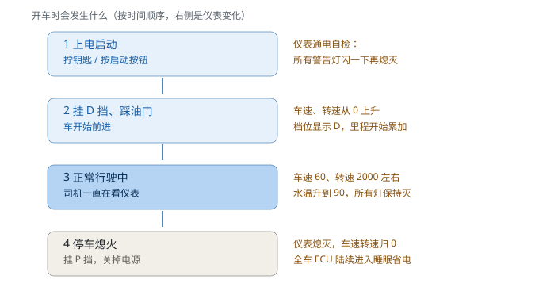

# 18 · 车载测试零基础常识速成

> **这一章不需要任何前置知识，也几乎不写代码。**
> 目标：让你在会议上听到"网关路由""刷写失败""EOL 检测""HIL 台架"这些词时
> **知道大家在说什么**，并且理解**自己写的脚本在整件事里的位置**。
>
> 读法建议：**通读一遍（约 40 分钟），不用背**。以后遇到不懂的词回来查。

---

## 18.0 先认识"车"（写给没开过车的人）

> **如果你连驾照都没有 —— 这一节就是为你写的。**
> 后面所有内容（为什么要测水温、转速和车速为什么该有关系、为什么要测睡眠）
> 都建立在这一节上。**别跳过。**
>
> 会开车/懂车的读者可以直接跳到 [18.1](#181-一辆车上有多少个电脑)。

---

### 18.0.1 一辆车是怎么跑起来的

先看两条"管道"：一条送**动力**（让车走），一条送**电**（让电子设备工作）。

**① 动力线：汽油 → 车轮**

```
   汽油 ──► [ 发动机 ] ──► [ 变速箱 ] ──► [ 车轮 ] ──► 车动起来
             烧油产生动力    调节力气大小    转起来就走
                 ↑                ↑
             你踩油门          你挂档位
            (踩得深→转得快)   (选哪组齿轮)
                 ↓                ↓              ↓
             仪表显示"转速"    仪表显示"档位"   仪表显示"车速"
```

**② 供电线：全车电子设备吃 12V 电**

```
   [ 发电机 ] ──► [ 12V 电网 ] ──► [ ECU / 屏幕 / 车灯 / 传感器 ]
    边开边发电      全车供电主干         所有用电设备
        ↑
   [ 蓄电池 ]  ← 发动机没转时（熄火后），靠它供电
```

> 📊 **图示**（`images/power_chain.svg`，Obsidian 里直接显示）：
>
> 

**五个角色的详细说明**（每个都给了具体数字）：

| 角色 | 干什么（大白话） | 关键数字 | 仪表上谁在显示它 |
|---|---|---|---|
| **发动机** | 烧汽油产生动力。"转速" = 它每分钟转多少圈 | 怠速 700~900 转/分<br>行驶 1500~3000<br>红线 6500（再高会坏） | **转速表** |
| **变速箱** | 像自行车的变速器：低速档力气大但跑不快，高速档跑得快但没劲 | 自动档通常 6~8 个前进档 | **档位显示**（P/R/N/D） |
| **冷却系统** | 发动机烧油会非常烫（上千度），用水循环降温 | 正常水温 80~105℃<br>**超过 120℃ 危险**（会拉缸报废） | **水温表** |
| **车轮** | 转起来车就走。转得快 = 车速快 | 直径约 0.65 米<br>**转一圈 ≈ 走 2 米** | **车速表**、**里程表** |
| **蓄电池 + 发电机** | 发电机边开边发电供全车用电；蓄电池存电（熄火后靠它） | 正常 12.6~14.8V<br>**冷启动瞬间跌到 9V** | **电池警告灯**（异常才亮） |

> 💡 **一个直观的换算**（帮你理解车速从哪来）：
> 车轮直径 0.65 m → 周长 ≈ 2 米。车速 60 km/h = 60,000 米/小时 = 16.7 米/秒。
> 16.7 ÷ 2 ≈ **每秒转 8 圈**。就这么简单 —— 车速的本质就是"车轮转多快"。
> （真实车用**轮速传感器**数轮子转数，再换算成车速）

---

### 18.0.2 开车是怎么回事（从上车到熄火）

你没开过车也没关系，下面这四步就是司机每次开车做的事，
**每一步都对应仪表上的一个变化** —— 而这些变化正是你要测的东西：

```
  ① 上电启动 ─────► ② 挂 D 挡踩油门 ─────► ③ 正常行驶 ─────► ④ 停车熄火
     拧钥匙/按按钮        车开始前进            一直在开           挂 P 挡关电源
        │                    │                    │                  │
        ▼                    ▼                    ▼                  ▼
   仪表通电自检          车速、转速            车速 60 km/h       仪表熄灭
   所有警告灯闪一下      从 0 开始上升          转速 2000          车速转速归 0
   再全部熄灭           档位显示 D            水温稳定 90℃       全车 ECU
   （约 2 秒）          里程开始累加          所有警告灯保持灭    陆续进入睡眠省电
```

> 📊 **图示**：

**把这四步翻译成你要做的事**（重要）：

| 司机的动作 | 系统内部发生了什么 | 你要测什么 |
|---|---|---|
| ① 拧钥匙上电 | 全车 ECU 上电，仪表跑**自检**（把 12 个警告灯全点亮 2 秒，证明灯没坏） | 自检是否点亮全部灯、是否按时熄灭（19 章场景 2） |
| ② 挂 D 挡起步 | 车速从 0 爬升；档位从 P 变 D | 档位切换时机对不对（REQ-CAN-006） |
| ③ 行驶中 | 各 ECU 周期发报文（车速 100ms 一帧） | 信号范围/联动/周期是否正常（19 章场景 1、8） |
| ④ 熄火 | 各 ECU **协商进入睡眠**（省电，防止亏电） | 睡眠协商、总线静默、能否被唤醒（19 章场景 12） |

> ⚠️ **注意：上面说的"自检灯闪一下"是真实车的行为，本项目的仿真仪表不做这件事**
> （你跑起来会看到灯一直灭）。仿真的自检要用 **19 章场景 2 的灯光测试例程**手动触发
> （`31 01 0301`）。**学的时候要分清"真实车怎样"和"仿真怎么模拟"** —— 这是两回事。

> ⚠️ **第 ④ 步是新手最容易忽略的**：很多人以为"熄火 = 断电"，其实熄火后
> 各 ECU 还要互相协商一阵才能睡。**任何一个节点睡不着，第二天车可能就打不着火** ——
> 这就是"暗电流"测试的意义（见 18.0.6）。

---

### 18.0.3 仪表盘长什么样

这是你以后每天要打交道的那块屏幕。真实仪表盘长这样（简化版）：

```
┌───────────────────────────────────────────────────────────┐
│  ● ● ● ● ● ● ● ● ● ● ● ●   ← 12 个警告灯（平时全灭，异常才亮）│
│                                                            │
│     ╭───────────╮                ╭───────────╮            │
│    ╱   80   100  ╲              ╱   3    4    ╲           │
│   │      ●───►    │            │      ●──►     │          │
│   │    60    120  │            │    2     5    │          │
│   │   车速表 km/h  │            │  转速表 ×1000 │          │
│    ╲   40   160  ╱              ╲   1    6    ╱           │
│     ╰───────────╯                ╰───────────╯            │
│                                                            │
│              D          ← 档位显示（现在挂 D 挡）           │
│        [水温 ████░░]  [油量 ██████░]  ← 条状表              │
│              12345 km    ← 总里程                           │
└───────────────────────────────────────────────────────────┘
```

> 📊 **图示**：

**每个元素的作用**（对照上图）：

| 位置 | 显示什么 | 单位/量程 | 正常值 | 不正常会怎样 |
|---|---|---|---|---|
| 顶部一排灯 | 12 个警告灯 | 亮/灭 | **全灭** | 亮起 = 有故障（下一步要看是哪个灯） |
| 左侧大圆 | **车速表** | km/h，0~240 | 看你开多快 | 显示与实际不符 = 你要抓的 bug |
| 右侧大圆 | **转速表** | ×1000 rpm，0~8 | 怠速 0.7~0.9<br>行驶 1.5~3.0 | 转速异常高/低 = 发动机或信号有问题 |
| 中间字母 | **档位** | P/R/N/D/S | D（前进时） | 显示不对 = 变速箱信号问题 |
| 中间条状 | **水温表** | ℃，0~130 | 80~105 | **超 120 = 危险**（会有灯亮 + 记故障码） |
| 中间条状 | **油量表** | E~F（空~满） | 别到 E | 到 E 会亮加油灯 |
| 底部数字 | **里程表** | km | 一直累加 | 不累加或倒退 = 累加器有 bug |

> 💡 **一个真实的场景**（帮你理解"测试在测什么"）：
> 客户投诉"我的车速表显示比实际慢了 5 km/h"。
> 你要做的：用脚本从总线上读车速信号 → 和仪表显示的对比 → 差值超容差就是缺陷。
> 这就是 19 章场景 1 和 10 在做的事。

---

### 18.0.4 档位 P/R/N/D/S 到底是什么

没开过车的人基本都搞不清这个，但它是仪表上最重要显示之一：

| 档位 | 英文全称 | 什么意思 | 什么时候用 | 车的行为 |
|---|---|---|---|---|
| **P** | Park（停车） | 锁住变速箱 | 停死不走了 | 车推不动 |
| **R** | Reverse（倒车） | 反向 | 倒车 | 往后走 |
| **N** | Neutral（空挡） | 动力断开 | 长时间等红灯、被拖车 | 踩油门不走（空转） |
| **D** | Drive（前进） | 自动前进 | **99% 的行驶时间** | 车自己会在 1~6 挡之间换 |
| **S** | Sport（运动） | 延迟换挡、动力更猛 | 超车、爬陡坡 | 转速拉得更高才换挡 |
| （L） | Low（低速） | 只用低挡 | 长下坡（用发动机制动） | 跑不快但有力 |

**仪表上会怎么显示**：通常是中间一个字母（`P` / `R` / `N` / `D`），
有的车还会显示具体档位（如 `D3` = D 挡下的第 3 挡）。

> 🧪 **测试关联**：本项目模拟的规则是"**车速 > 1 km/h → 档位自动从 P 变 D**"，
> 对应需求 `REQ-CAN-006`，测试用例在 `scenarios/01_powertrain_signals.robot`。
> 真实车的换挡逻辑复杂得多（看车速 + 油门 + 坡度），但**测试思路一样**：
> 给一个工况，验证档位是不是该变的那个值。

---

### 18.0.5 为什么"转速"和"车速"必须有固定关系

这是测试里最重要的一条"物理常识"。

**先用自行车类比**（你一定骑过自行车）：

```
自行车：  你蹬踏板的转速 × 齿轮比 = 车轮转速

  小齿轮（省力档）：蹬 1 圈 → 轮子转 1 圈     ← 费力但爬坡有劲
  大齿轮（省力档）：蹬 1 圈 → 轮子转 0.5 圈   ← 轻松但跑不快
```

汽车完全一样：**在某个档位下，发动机转多少圈 → 车轮转多少圈，是固定的**（齿轮比）。

所以：

```
    转速 ≈ 车速 × 系数        （同一个档位时，这个系数是固定的）
```

**用本项目（模拟车）的具体数字算一遍**：

| 车速 | 预期转速（本项目模型：转速 = 车速 × 80） | 真实车（D 挡 6 挡）大约 |
|---|---|---|
| 0 km/h（怠速） | 800 rpm | 700~900 rpm |
| 20 km/h | 1600 rpm | 1300 rpm |
| **60 km/h** | **4800 rpm** | **1800 rpm** |
| 100 km/h | 8000 rpm（在 0~16000 量程内，仅示例） | 2800 rpm |

> 📌 注意：本项目为了测试简单，用了 `转速 = 车速 × 80` 这个简化模型；
> 真实车因为有 6~8 个档位，转速和车速的关系是**分段折线**（换挡时转速会掉一下）。
> **但"某个档位下车速和转速成正比"这件事，真车和模型车是一样的。**

**为什么这个关系对你的测试特别重要**：

```
❌ 只断言"转速在 0~8000 范围内"  →  永远通过，查不出任何问题
✅ 断言"转速 ≈ 车速 × 80"        →  ECU 若把系数写成 ×60，立刻暴露
```

真实工作里，ECU 的**标定参数写错**是常见缺陷（参数表里一个数写错），
**只有联动断言能抓住它** —— 这就是 19 章场景 1 里那条"转速应与车速保持设计比例"。

---

### 18.0.6 12V 电从哪来（为什么测试要测电压）

车上所有 ECU 都吃 **12V 直流电**（乘用车；卡车是 24V）。来源：

```
  发动机转起来 ──► 发电机发电 ──► 给全车供电 + 给蓄电池充电
                      │
                      └─ 熄火后：发电机不转，只有蓄电池供电
```

**三种电压工况**（你会真的测它们）：

| 工况 | 电压 | 什么时候发生 | 后果 | 对应的测试 |
|---|---|---|---|---|
| **正常** | 13.8V（±1） | 行驶中 | 一切正常 | 基线 |
| **低压** | 跌到 **9V** | **冷启动瞬间**（起动机耗电巨大） | 部分 ECU 可能重启 | 记 P0562，核心功能不能中断（19 章场景 11） |
| **过压** | 升到 **16V+** | 发电机调节器失效 | 灯泡/屏幕可能烧掉 | 记 P0563，保护输出 |

**为什么要专门测"熄火后的耗电"（暗电流）**：

```
  熄火后，全车 ECU 进入"睡眠" → 此时整车耗电必须 < 20mA（毫安）

  如果某个 ECU 没睡着（还在偷偷发报文）：
     耗电 100mA × 放一晚上 12 小时 ≈ 1.2Ah
     而蓄电池容量约 60Ah → 一周左右就亏电打不着火
```

> 🧪 **这就是为什么"熄火后节点偷偷发报文"是严重问题** ——
> 不是"费点电"那么简单，是**整车级指标**。19 章场景 12 就是在验证这套睡眠协商机制。

---

### 18.0.7 把这些概念对到你的测试工作上（汇总）

学完这节，你应该能把"车上的事"和"你要写的用例"连起来：

| 车上的概念 | 你会写的测试 | 在哪个文件 |
|---|---|---|
| 车速有物理范围 | 读车速信号，断言 0~250 且接近目标值 | `scenarios/01_powertrain_signals.robot` |
| 转速与车速联动 | 断言 `转速 ≈ 车速 × 80` | 同上（第 2 条用例） |
| 档位随车速切换 | 等车速 > 1 后断言档位 = D | 同上（第 4 条用例） |
| 12 个警告灯 | 无故障全灭；自检时全亮 | `scenarios/02_telltale_matrix.robot` |
| 水温超 120 危险 | 造 125℃ 场景 → 断言灯亮 + 记 DTC | `scenarios/04_dtc_lifecycle.robot` |
| 12V 电压工况 | 注入 9V/16V → 断言记 P0562/P0563 | `scenarios/11_fault_injection.robot` |
| 熄火后睡眠 | IGN OFF → 断言应用报文停发 → 总线零帧 | `scenarios/12_power_management.robot` |
| 唤醒 | 发任意报文 → 断言节点恢复发送 | 同上 |

**一句话总结这一节**：
> 车 = **动力链**（发动机→变速箱→车轮）+ **12V 供电网**；
> 仪表 = 把这些系统状态**显示给人看**的窗口；
> 你的工作 = **验证这个窗口显示的数字，和系统真实状态一致**（且异常时该报警就报警）。

---

## 18.1 一辆车上有多少个"电脑"？

先破一个新手最常见的误解：**汽车不是"一个电脑 + 一堆机械零件"**，
而是**几十到上百个小电脑用网线连起来**。

### 18.1.1 什么是 ECU

**ECU = Electronic Control Unit（电子控制单元）** —— 通俗说就是"车上的一个小电脑"，
每个负责一件事。

> 📌 **下面表格里的英文缩写一个都不用背**（写全称只是方便你以后查）。
> 你要记住的只有一句：**每个域有一批 ECU，各管一摊事，它们互相通信**。
> 领域词汇见得多了自然记住，现在扫一眼就行。

| 域 | ECU 举例 | 它管什么 |
|---|---|---|
| **动力域** | 发动机 ECU（EMS）、变速箱 ECU（TCU） | 喷油点火、换挡 |
| **底盘域** | ABS/ESP、EPS（转向助力） | 刹车防抱死、转向 |
| **车身域** | BCM（车身控制器） | 车门、车窗、灯光、雨刮 |
| **座舱域** | 仪表（Cluster）、车机（IVI/HU）、空调控制器 | 显示、娱乐、空调 |
| **智驾域** | ADAS 域控、雷达/摄像头 ECU | 辅助驾驶 |
| **网联** | T-Box（车联网盒子） | 4G/5G、远程控制、OTA |

**为什么不是一个中央电脑全干**：
- 各系统的实时性要求不同（刹车必须毫秒级，空调慢点没关系）
- 一个坏了不能全车瘫痪（分布式更安全）
- 不同供应商做不同模块（OEM 从博世买 ABS、从伟世通买仪表）

> 💡 **本项目模拟的**就是"动力域 ECU + 仪表 + 车机"这三个典型节点。
> 你写的每个脚本，都是在和这样的小电脑打交道。

### 18.1.2 零件是谁做的：OEM、Tier1、Tier2

| 角色 | 是谁 | 例子 | 干什么 |
|---|---|---|---|
| **OEM**（主机厂） | 整车厂 | 通用、大众、比亚迪、蔚来、理想 | 定义整车需求、总装、卖车 |
| **Tier1**（一级供应商） | 直接给 OEM 供模块 | 博世、大陆、伟世通、德赛西威 | 做 ECU/仪表/域控，**负责测试交付** |
| **Tier2**（二级供应商） | 给 Tier1 供零件 | 芯片厂、屏厂 | 提供元器件 |

> **面试/工作关联**：Tier1 的测试工程师（就是你可能去的岗位）负责
> "按 OEM 给的规范，验证自己做的模块对不对，并交测试报告"。

---

## 18.2 这些电脑怎么互相说话？

### 18.2.1 CAN 总线：一根"对讲机频道"

车上一根双绞线上挂着所有 ECU，谁都可以发话，所有 ECU 都能听到 ——
这叫**总线（Bus）**，最常见的协议是 **CAN**（Controller Area Network）。

**生活类比**：像一个对讲机频道。

- 你在频道里喊"车速 60" → **所有**挂在线上的设备都听到了
- 但每个设备**只关心自己需要的**：仪表听到后显示指针，ABS 听到后判断要不要介入，
  空调则当没听见
- 频道里不能同时两个人喊（会撞），所以有**优先级**机制（刹车相关的话优先发）

> **为什么不用 WiFi/蓝牙/USB**：CAN 是**可靠 + 实时 + 便宜 + 抗干扰**的组合——
> 两根线、几块钱成本、毫秒级确定性延迟、车上电磁干扰大也不怕。
> 详见 [02 章](02_车载网络基础.md)。

### 18.2.2 报文（Frame）：一条"短信"

在总线上喊一次话，就是发了一**帧报文**（Frame，也叫报文）：

```
ID = 0x100        ← "这是车速相关的消息"（相当于短信的"发件主题"）
数据 = C4 09 80 0C 82 33 00 00    ← 8 个字节的内容（相当于短信正文）
```

**ID 是"消息类型"，不是"谁发的"** —— 这点和网络编程里的 IP 地址完全不同，
新手最容易搞混：

| 概念 | 网络（IP） | 车载（CAN） |
|---|---|---|
| 标识 | 地址 = "谁" | **ID = "什么事"** |
| 谁发的 | 由源地址知道 | **不告诉你**（谁需要都可以发） |
| 冲突处理 | 路由器排队 | **ID 越小优先级越高**（实时抢总线） |

### 18.2.3 信号（Signal）：短信里的"字段"

8 个字节挤着放了很多信息，每段叫一个**信号**：

`C4 09 80 0C 82 33 00 00` 里可以同时包含：
- 车速（占第 0-15 位，精度 0.01 → 值 25.00 km/h）
- 转速（占第 16-31 位 → 值 3000 rpm）
- 水温、油门位置……

**怎么知道哪几位是什么**？靠 **DBC 文件**——它就是**车上的字典**：

```
报文 EngineData(0x100):
  VehicleSpeed  第0-15位  精度0.01  单位km/h
  EngineSpeed   第16-31位 ...
```

> **写脚本的意义就在这**：你不用手算字节（`0xC4 0x09` → 25.00），
> 库会按 DBC 自动解码。你写 `Read Signal From Bus    EngineData    VehicleSpeed` 就行。

### 18.2.4 周期报文：ECU 在"定时喊话"

ECU 不是想说才说，而是**按固定周期反复发**：

| 报文 | 周期 | 为什么 |
|---|---|---|
| 车速/转速 | 100 ms | 变化快，要勤发 |
| 水温等慢变量 | 200 ms | 变化慢 |
| 警告灯状态 | 500 ms | 不需要那么勤 |

**这解释了两件事**：
1. 为什么你的脚本"读一次"就能拿到值（总线上一直在发）
2. 为什么测试里要检查"**周期抖动**"（该 100ms 发的，如果 150ms 才发就说明 ECU 有问题）

---

## 18.3 诊断：给车做"体检"的专用通道

### 18.3.1 4S 店那根线是什么

你在 4S 店看到的：技师插一个盒子（诊断仪）到车上，读出故障码 ——
这就是**诊断（Diagnostics）**，协议叫 **UDS**（统一诊断服务）。

**为什么车必须有诊断能力**：
- **售后**：车坏了，要能告诉技师"哪坏了"（不然只能拆）
- **产线**：出厂前每台车要自检（EOL 下线检测），几分钟内验证所有功能
- **开发**：研发阶段反复刷程序、读数据
- **法规**：OBD 法规要求车辆必须能报告排放相关故障

### 18.3.2 诊断和 CAN 报文的关系

**诊断也是 CAN 报文**！只是用了专门的 ID：

| ID | 方向 | 含义 |
|---|---|---|
| `0x7E0` | 诊断仪 → ECU | 我发的请求 |
| `0x7E8` | ECU → 诊断仪 | ECU 的响应 |

所以诊断仪的本质就是：**往 0x7E0 发一帧特殊格式的报文，等在 0x7E8 收回答复**。
你的脚本 `Send UDS Request    22 F1 87` 干的就是这件事。

### 18.3.3 诊断的"规矩"：会话与权限

诊断服务不是随时都能用的，有两个门槛（**新手最容易忽略**）：

**门槛 1：会话（Session）** —— 像"工作模式"
- **默认会话**：车正常开着的状态，只允许"读"（读版本、读故障码）
- **扩展会话**：允许更多操作（写数据、跑自检例程）
- **编程会话**：刷写固件专用

**门槛 2：安全访问（Security Access）** —— 像"密码锁"
- 敏感操作（写数据、刷写）必须先做一次"**种子-密钥握手**"：
  你问 ECU 要个随机数（种子），按约定算法算出密钥发回去，对了才放行
- 防止有人随便插个设备就改车

> **写脚本的意义**：所以"写数据"用例永远是三步——
> `Enter Extended Session` → `Security Unlock` → 写。
> 这也是为什么你写的负向用例要验证"**没解锁时真的拒绝了**"（NRC 0x33）。

### 18.3.4 常见诊断服务干什么用（记 6 个就够）

| 服务 | 干什么 | 类比 |
|---|---|---|
| `0x10` 会话控制 | 切换工作模式 | 进入工程模式 |
| `0x22` 读数据 | 读 ECU 里的数据（版本号、VIN） | 查档案 |
| `0x2E` 写数据 | 写配置/标定数据 | 改档案（要权限） |
| `0x19` 读故障码 | 读历史故障 | 查病历 |
| `0x14` 清故障码 | 清除故障记录 | 清病历（治病还得靠修） |
| `0x27` 安全访问 | 解锁权限 | 输入密码 |

---

## 18.4 故障码（DTC）：车的"病历本"

### 18.4.1 长得像 `P0116` 的那串字符

**DTC = Diagnostic Trouble Code**，格式是**一个字母 + 4 位数字**：

```
P 0 1 1 6
│ │ └─┬─┘
│ │   └── 具体故障编号
│ └────── 0=通用标准, 1=厂商自定义
└──────── 故障域：P=动力 B=车身 C=底盘 U=网络
```

所以 `P0116` = 动力域、标准码、编号 0116 → 查表是"**发动机冷却液温度传感器电路范围/性能**"。

**新手提示**：具体含义不用背，网上搜"P0116"就有。你要知道的是
**字母代表哪个域**（P/B/C/U），这能帮你快速判断是谁的问题。

### 18.4.2 故障码不是"一下子就有"的：状态机

这是**新手写脚本时最常困惑的点**：为什么注入故障后要等好几秒 DTC 才出现？

因为 DTC 有**状态位**和**确认周期**：

```
① 检测到异常        → pending（待定）    ← 只在 ECU 内部记着
② 连续 N 个循环都异常 → confirmed（已确认）← 这时才点灯、才报给诊断仪
③ 故障消失后继续 N 个循环正常 → 逐渐 aging（老化）
④ aging 满 40 个循环 → 自动清除
```

**为什么设计这么麻烦**：防止**误报**。传感器偶尔跳一下就点灯，车主会疯。
"连续 2 个循环都异常"才能确认是真故障。

> **写脚本的意义**：这就是为什么 L6 练习里"等灯亮"要给 25 秒超时
> —— 水温要爬升（物理惯性）**加上** 2 个诊断周期确认（逻辑要求）。

### 18.4.3 快照（冻结帧）：故障现场的照片

DTC 记录时，ECU 会**把当时的关键数据存下来**（车速、水温、转速……），
叫**快照/冻结帧**。修车时技师看快照就知道"故障发生那一刻车在什么状态"。

> 类比：行车记录仪的紧急录像。

### 18.4.4 MIL 灯：仪表上那个"小发动机"

**MIL = Malfunction Indicator Lamp**（故障指示灯）—— 仪表上那个发动机形状的黄灯。
它是**排放相关故障**的法定指示灯（法规要求必须亮）。

**要点**：MIL 是**保持型（latch）**的 —— 故障消失了也不会自动灭，
要清码或修好并跑够循环才灭。其他灯（如水温灯）通常是非保持的。

---

## 18.5 刷写（Flash）：给车"重装系统"

### 18.5.1 是什么

**刷写/编程（Programming/Flashing）** = 把新的固件（软件）写进 ECU。
类比：**给手机刷系统 / OTA 升级**。

**什么时候要刷**：
- 修 bug、加功能（版本迭代）
- 产线装车时写入配置
- 召回时统一升级

### 18.5.2 为什么要四步（新手看这个就懂刷写脚本了）

```
① 进编程会话        让 ECU 从"干活模式"切到"升级模式"
② 安全解锁          证明你有权限
③ 请求下载 + 传数据  告诉 ECU "我要写 128 字节到某地址"，然后分块传
④ 校验 + 退出        检查数据完整，重启生效
```

**为什么分块传**：固件可能几 MB，CAN 一帧只能 8 字节 —— 所以要切成一堆小块，
每块编号（块 1、块 2……），ECU 按序号校验（**序号错乱就拒绝**，防止丢块）。

**为什么刷写有风险**：刷一半断电 → ECU 变砖。所以真实流程有严格保护
（Bootloader、双分区、校验和）。

> **写脚本的意义**：本项目 06 套件就是把这条流程做成 11 个自动化用例，
> 包括"块序号错乱应该被拒""字节数不足应该报校验失败"这些**负向路径**。

### 18.5.3 OTA 和刷写的区别

|  | 刷写（诊断刷写） | OTA |
|---|---|---|
| 场景 | 产线、4S 店（有线） | 车主在家（无线） |
| 通道 | 诊断口（OBD）+ CAN | T-Box + 4G/WiFi |
| 相同点 | **底层都是往 ECU 写固件**，都要校验、分块、防砖 | |

---

## 18.6 一辆车是怎么"测"出来的

### 18.6.1 V 模型（一句话版）

汽车电子开发的经典流程是**V 字形**：

```
需求定义 ────────────────► 整车验收测试        （右上是"对照需求验"）
  系统设计 ───────────► 系统集成测试
    软件设计 ───────► 软件单元测试
       编码 ─────►（写代码）
```

**核心思想**：**左边每一层设计，右边都要有对应的一层测试**（"V"的两臂对应）。
这就是为什么要写测试用例 —— **不是"顺便测一下"，而是流程强制的交付物**。

### 18.6.2 测试的几大阶段（按时间顺序）

| 阶段 | 在哪里测 | 被测对象 | 用什么 |
|---|---|---|---|
| **MIL/SIL** | 电脑上 | 代码/模型 | 仿真软件 |
| **台架（Bench）** | 实验室 | 真实 ECU + 仿真负载 | CANoe + 电源 + 负载盒 |
| **HIL** | 实验室 | 真实 ECU + 仿真整车 | dSPACE/Vector 的 HIL 系统 |
| **实车** | 车上 | 整车 | 真实环境、路试 |
| **产线 EOL** | 工厂 | 每台下线车 | 下线检测设备 |

**新手最该记住**：**大部分自动化脚本跑在"台架"阶段** ——
真实 ECU + 电脑模拟的其余部分（缺什么补什么）。本项目就是这个思路的**纯软件版**。

### 18.6.3 台架长什么样

想象一张桌子：
- 上面摆着**真 ECU**（被测对象）
- 连着**电源**（模拟 12V/24V）
- 连着 **CANoe**（总线分析工具 + 仿真其余节点）
- 连着**负载盒**（模拟真实负载：灯、电机）
- 连着**诊断仪**（就是你的脚本在做的事）

**CANoe 是什么**：车载行业最通用的**总线分析/仿真工具**（Vector 公司）。
能看总线报文、仿真节点、跑诊断、录 Trace。**它不是开源的，很贵**，
所以本项目用 Python 自己做了一套开源替代，但**思路完全一致**。

> 面试时可以说："我没接触过 CANoe，但我用 Python 实现过等价的能力：
> 虚拟总线、DBC 解码、UDS 诊断、CAPL 式的周期报文发送、Trace 导出（格式兼容 CANoe）。"
> —— 这比"我不会 CANoe"强一百倍。

---

## 18.7 测试工程师的一天（真实日常）

让你有心理预期：

| 时间 | 干什么 |
|---|---|
| 早会（15 min） | 昨天测了什么、今天计划、有没有阻塞 |
| 上午 | 按测试规范写/改脚本、跑测试、看失败 |
| 中午 | 和开发对问题（"这个 DTC 不是我测出来的，是 ECU 逻辑不对"） |
| 下午 | 复现问题、抓 Trace、写测试报告、提 Bug 单 |
| 傍晚 | 更新用例库、维护回归集、和需求方对齐模糊点 |

**技能分布（大致）**：
- 40% 理解需求和被测系统（**基础常识越多，这块越快**）
- 30% 写脚本 + 调脚本
- 20% 分析失败（是产品问题还是测试问题？）
- 10% 沟通与文档

**关键心态**：测试不是"点点点"，是**用系统的方法证明或证伪"产品符合需求"**。

---

## 18.8 行业黑话速查（听到别懵）

| 黑话 | 全称/含义 | 人话 |
|---|---|---|
| **SOP** | Start of Production | 量产开始（车能卖了） |
| **A/B/C 样** | A样/B样/C样车 | 试制阶段：A 样≈手工样件，C 样≈接近量产 |
| **DV/PV** | Design/Production Validation | 设计验证 / 生产验证 |
| **PPAP** | Production Part Approval Process | 供应商量产件批准流程 |
| **EOL** | End of Line | 产线下线检测（每台车必过） |
| **HIL** | Hardware-in-the-Loop | 硬件在环：真 ECU + 仿真环境 |
| **DUT** | Device Under Test | 被测对象（就是指那块 ECU） |
| **DBC** | CAN 数据库文件 | 车上的字典（哪几位是什么信号） |
| **ARXML** | AUTOSAR XML | 新版"字典"格式（AUTOSAR 标准用） |
| **UDS** | Unified Diagnostic Services | 诊断协议（ISO 14229） |
| **DTC** | Diagnostic Trouble Code | 故障码（P0116 这种） |
| **NRC** | Negative Response Code | 负响应码（"我拒绝，原因是…"） |
| **DID** | Data Identifier | 数据标识（读数据时给的编号） |
| **MIL** | Malfunction Indicator Lamp | 仪表上的发动机故障灯 |
| **Telltale** | — | 仪表上所有警告灯的统称 |
| **IPC/IC** | Instrument Panel Cluster / Cluster | 仪表盘 |
| **HU/IVI** | Head Unit / In-Vehicle Infotainment | 车机（中控屏） |
| **BCM** | Body Control Module | 车身控制器 |
| **EMS/ECM** | Engine Management System | 发动机控制器 |
| **TCU** | Transmission Control Unit | 变速箱控制器 |
| **ADAS** | Advanced Driver Assistance Systems | 高级辅助驾驶 |
| **T-Box** | Telematics Box | 车联网模块（4G/OTA） |
| **OTA** | Over-The-Air | 远程升级 |
| **域控 / 域控制器** | Domain Controller | 一个盒子管一个域（替代一堆小 ECU） |
| **网关** | Gateway | 负责"域之间的翻译与转发" |
| **CANoe** | Vector 的总线工具 | 车载测试"瑞士军刀" |
| **CANalyzer** | Vector 的分析工具 | 看总线用 |
| **CAPL** | CANoe 的脚本语言 | 写仿真节点用（类似本项目里 Python 的角色） |
| **vTESTstudio** | Vector 的测试开发工具 | 写自动化测试用 |
| **ecu.test / TEST-GUIDE** | tracetronic 的测试执行/报告工具（别和 dSPACE/Vector 混了） | 测试执行与报告 |
| **刷写/编程** | Flashing/Programming | 给 ECU 装固件 |
| **Bootloader** | — | 刷写专用的小程序（保命用的） |
| **标定** | Calibration | 调 ECU 参数（喷多少油、什么时候换挡） |
| **下线/整车下线** | EOL | 产线最后一道检测 |
| **Tier1 / OEM** | — | 供应商 / 主机厂 |
| **SOW / RFQ** | Statement of Work / Request for Quotation | 工作说明书 / 报价请求 |
| **Issue / Jira 单** | — | 缺陷跟踪（开发用） |
| **Test Spec** | Test Specification | **测试规范**：把需求翻译成可执行测试项 |
| **RTM** | Requirements Traceability Matrix | **需求追溯矩阵**：需求↔用例↔结果三向可查 |
| **Test Plan** | — | 验证计划：范围/策略/排期/通过准则 |
| **Exit Criteria** | — | 通过准则（什么算"验完"了，没有它项目永远验不完） |
| **DOORS / Jama / Codebeamer** | — | 需求与测试管理工具（Test Spec 通常维护在这里） |
| **DVP&R** | Design Verification Plan & Report | 设计验证计划与报告（整车厂的验证交付物） |
| **NM** | Network Management | **网络管理**：各节点协商"能不能睡了"的机制 |
| **暗电流 / 静态电流** | Quiescent / Dark Current | 熄火后整车耗电（通常要求 < 20mA，超标会亏电打不着火） |
| **工程模式 DID** | Engineering / Development Mode | 用于注入测试条件的特殊数据标识（台架/产线用） |
| **唤醒源** | Wake-up Source | 能让休眠节点醒来的事件（CAN 活动/IGN ON/车门/遥控） |
| **Power Mode** | — | 电源模式：OFF / ACC / IGN / CRANK |
| **功能安全 / FuSa** | Functional Safety | "电子系统坏掉也不能伤人"——汽车行业的安全总纲 |
| **ISO 26262 / ASIL** | — | 功能安全的国际标准；ASIL 是它定义的等级（A~D，D 最严，刹车转向通常 D） |
| **ASPICE** | Automotive SPICE | 汽车**开发流程**标准（客户按它审核供应商） |
| **AUTOSAR** | — | 汽车软件架构标准（统一通信/诊断接口，ARXML 是它的配置格式） |
| **MIL / SIL / HIL** | — | 测试的三个层次：纯仿真 → 跑真代码 → 真硬件在环（越往后越真实） |

---

## 18.9 新手最容易搞错的 12 件事

1. **"ID 是发送方地址"** ❌ → ID 是**消息类型**（0x100 是"车速消息"，谁都能发）
2. **"车上是一个大电脑"** ❌ → 是**几十上百个小 ECU** 连在总线上
3. **"故障码出现 = 零件坏了"** ❌ → 只说明"检测到异常"，可能误报、也可能是线路问题
4. **"清了码就是修好了"** ❌ → 清码只是清记录，故障条件还在就会重新记录
5. **"诊断就是读故障码"** ❌ → 诊断是一整套服务（读/写/刷写/例程）
6. **"CAN 和诊断是两个东西"** ❌ → **诊断跑在 CAN 上**（用 0x7E0/0x7E8 两个 ID）
7. **"测过了就不用回归"** ❌ → 任何改动都可能弄坏旧功能 → 回归测试必须有
8. **"测试失败就是产品有问题"** ❌ → 先排除：环境没起来？脚本写错？时序不够？
9. **"报文周期越快越好"** ❌ → 周期是设计指标，**抖动**才是关键（该 100ms 就要 100ms）
10. **"自动化能替代手工测试"** ❌ → 自动化擅长回归和重复，探索性测试还得靠人
11. **"测试就是跑用例"** ❌ → System Validation 交付的是**证据链**（需求→用例→追溯→报告），
    只跑用例不写追溯，客户审核时答不上"这条需求验了吗"
12. **"熄火后节点不发报文是省电优化"** ❌ → 那是**硬指标**：整车暗电流 <20mA，
    任何节点偷偷发报文都会导致车主第二天打不着火

---

## 18.10 本章自检（能答出来就可以去写脚本了）

**第一部分：车与仪表（对应 18.0，没开过车的人重点答这 4 道）**

1. 车上的动力是怎么从汽油传到车轮的？（说出三个中间环节）
2. 档位 P / R / N / D 分别什么时候用？正常行驶时挂哪个？
3. 为什么"转速"和"车速"之间存在固定比例关系？（能用自行车变速类比说清最好）
4. 为什么熄火后各 ECU 要"睡着"？不睡会有什么后果？

**第二部分：电子与协议**

5. ECU 是什么？为什么车上有几十个而不是一个？
6. CAN 报文里的 ID 表示"谁发的"还是"什么事"？
7. DBC 文件是干什么用的？（用一句话说给非技术的人听）
8. 诊断和 CAN 报文是什么关系？诊断请求发到哪个 ID？
9. 为什么"写数据"要先做安全访问？种子-密钥是干嘛的？
10. DTC 为什么不是"一检测到就点灯"？确认周期解决什么问题？
11. 刷写为什么要分块？块序号有什么用？

**第三部分：流程与行业**

12. V 模型的核心思想是什么？（为什么左边每层都要有右边的测试）
13. CANoe 是什么？本项目是怎么"平替"它的？
14. 台架、HIL、实车、EOL，分别在哪里测、测什么？
15. Tier1 和 OEM 谁给谁提需求？
16. 说出 5 个你以前不懂、现在懂了的黑话。

### 📋 自查要点（答完再对，别提前看）

| # | 自查要点（能说出关键词就算过） |
|---|---|
| 1 | 汽油 → **发动机 → 变速箱 → 车轮**（发动机烧油、变速箱调力道、车轮转起来） |
| 2 | **P** 停死不动时用、**R** 倒车、**N** 空挡（等红灯/拖车）、**D** 正常行驶 ← 行驶挂 D |
| 3 | 同一档位下**齿轮比固定** → 发动机转多少圈，车轮就转多少圈（就像自行车某个档位） |
| 4 | **防止亏电**：整车暗电流要求 < 20mA；某个节点不睡，一晚就能把蓄电池放空 → 第二天打不着火 |
| 5 | 车上的小电脑；分布式的原因：实时性不同 / 坏一个不全瘫 / 不同供应商分工 |
| 6 | **"什么事"，不是"谁发的"** ← 最关键的一条，答反了要回去重读 18.2 |
| 7 | "车上的字典" —— 定义哪几位是什么信号 |
| 8 | 诊断也跑在 CAN 上；请求发到 **0x7E0**，响应在 **0x7E8** |
| 9 | 安全设计（防止随便插设备就改车）；种子=ECU 给的随机数，密钥=按约定算法算出的应答 |
| 10 | 防误报 —— 连续 N 个诊断周期异常才确认，避免传感器偶然跳动就报警 |
| 11 | 一帧只有 8 字节装不下固件；块序号用来发现"丢块"（丢了就拒绝） |
| 12 | 左边每一层设计，右边都有对应的一层测试（需求↔验收、设计↔集成…） |
| 13 | Vector 的商业总线工具；本项目用 Python 做了**等价能力**（虚拟总线/DBC 解码/UDS/Trace 导出），思路一致 |
| 14 | 台架=实验室（真 ECU + 仿真其余部分）；HIL=真 ECU + 仿真整车；实车=装在车上路试；EOL=产线上每台车下线检测 |
| 15 | **OEM（整车厂）给 Tier1 提需求**；Tier1 做完交付并接受审核 |
| 16 | 自由发挥 —— 能脱口而出 5 个就说明真读进去了 |

> **怎么判断自己"过了"**：不看答案，能**用自己的话**讲出来（能举个例子更好），
> 而不是"看着眼熟"。眼熟是假掌握 —— 这是新手最容易骗自己的地方。
> 卡在某题上：回去重读对应小节（题目旁已标出章节号）。

---

---

**上一章：[17 · 从需求到脚本](17_从需求到脚本.md)** ｜ **下一章：[19 · 十六个场景脚本实战](19_十六个场景脚本实战.md)**
