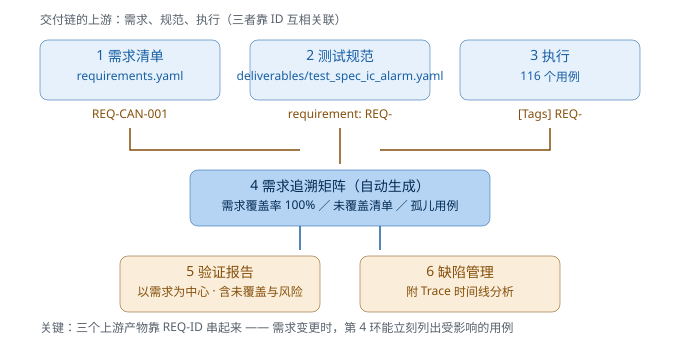

# 20 · 测试规范与验证交付物（System Validation 的工作流）

> **这一章回答岗位名里的那个词：System Validation 到底"交付"什么。**
>
> 前 19 章的技能（写脚本、诊断、故障注入、电源管理）是**手段**；
> 这一章讲**目的**：怎么把手段组织成客户能验收、审核能通过、需求能追溯的交付物。
>
> 配套产物在 `deliverables/`，可直接当模板用。

---

## 20.1 为什么"会写脚本"还不够

一个真实的差别：

| | 只会写脚本的人 | System Validation 工程师 |
|---|---|---|
| 回答的问题 | "我跑了 276 个用例，都过了" | "**每条需求都被验证过**，这里是追溯矩阵和报告" |
| 需求变了 | 手工找哪些用例受影响 | 追溯矩阵自动列出**受影响的用例清单** |
| 客户问"XX 功能验了吗" | 翻 log 找 | 查 RTM，30 秒给答案 + 证据链接 |
| 报告怎么写 | 贴一段 Robot 摘要 | 按需求维度组织，含未覆盖项与遗留风险 |
| 出了问题 | "测试挂了" | 缺陷单带 Trace + 根因分析，开发直接定位 |

**核心差异**：System Validation 交付的是**证据链**，不是"跑过的记录"。

---

## 20.2 完整交付链（六环）

```
① 需求          requirements/requirements.yaml    ← 从 SRS 摘录（124 条）
     │  需求必须"可测"（有数值/条件/判定标准）
     ▼
② 测试规范      deliverables/test_spec_*.yaml     ← 把需求翻译成测试项
     │  每个测试项挂需求 ID；含前置/步骤/期望
     ▼
③ 执行（自动化） tests/robot/ + scenarios/        ← 用例用 [Tags] 挂需求 ID
     │  276 个用例，按需求/标签可筛选执行
     ▼
④ 追溯矩阵      trace_matrix.py → RTM             ← 需求 ↔ 用例 ↔ 结果
     │  自动答"哪些需求没覆盖""哪些用例没需求"
     ▼
⑤ 验证报告      deliverables/verification_report  ← 以需求为中心的交付物
     │  含结论/覆盖/缺陷/未覆盖/遗留风险
     ▼
⑥ 缺陷管理      deliverables/defect_report        ← 带 Trace 与根因分析
```

> 📊 **图示**：

**六环缺一不可**：缺 ① 就没法追溯；缺 ② 就是"测了个寂寞"；缺 ④ 就没法向客户
证明覆盖完整；缺 ⑤⑥ 则前面全白做。

---

## 20.3 第一环：需求清单与"可测性"

**坏需求**（不可测）：

> "仪表应正确显示车速。" ← 什么叫"正确"？允许多大误差？

**好需求**（可测）：

```yaml
- id: REQ-HMI-001
  title: 仪表车速与总线一致
  description: 稳态下仪表显示车速与总线信号偏差 ≤3 km/h
  source: SRS-10.1.1
  priority: High
  method: Test
  verify: 等稳态后比较（跨系统一致性）
```

**需求可测性评审**（Review requirements to ensure testable）——这是 JD 里明写的
职责。拿到需求先问四个问题：

| 问题 | 不可测的表现 | 怎么改 |
|---|---|---|
| 有**判定标准**吗？ | "显示正确" | "偏差 ≤3 km/h" |
| 有**前置条件**吗？ | 没说在什么状态测 | "稳态下 / 上电后 5 秒内" |
| 有**异常行为**定义吗？ | 只写了正常流程 | "信号丢失时保持最后值" |
| 有**优先级/来源**吗？ | 不知道谁提的、多重要 | 挂 SRS 章节号 + High/Med/Low |

> **面试话术**："我做的需求评审会先过一遍**可测性四问**，把'显示正确'这类
> 模糊表述打回需求方 —— 需求不可测，后面所有测试活动都是无效的。"

---

## 20.4 第二环：测试规范（Test Spec）

**这是 System Validation 的核心产出**：把需求翻译成"别人照着能执行"的测试项。

真实项目里它放在 **Jama / DOORS / Codebeamer / Excel** 里；本项目用 YAML 表达
同样的结构（见 [`deliverables/test_spec_ic_alarm.yaml`](../deliverables/test_spec_ic_alarm.yaml)）：

```yaml
- id: TC-ALM-001
  title: 水温超限应点亮水温报警灯并记录故障
  requirement: REQ-DTC-001          # ← 挂需求（追溯链的源头）
  method: Test                       # Test/Analysis/Inspection/Demonstration
  priority: High
  precondition: ECU 以 coolant=125 启动（超 120℃ 阈值）
  steps:                             # 人执行的步骤（可复现的关键）
    - 等待水温爬升至 120℃ 以上
    - 等待故障确认周期（连续 2 个诊断周期）
  expected:                          # 必须可判定
    - 仪表水温报警灯点亮（CoolantTempHigh = 1）
    - DTC P0116 为 confirmed 状态
  automation: scenarios/04_dtc_lifecycle.robot::故障条件持续时应记录为 confirmed 状态
```

### 20.4.1 五个写法要点

1. **每个测试项必挂需求 ID** —— 否则追溯链断在源头
2. **precondition 写清系统状态** —— 90% 的"复现不了"都因为前置条件没写
3. **steps 是可复现的步骤**（不是"验证功能正常"这种废话）
4. **expected 必须有判定标准**（数值/状态码，不写"显示正常"）
5. **正/负/边界三项齐全**（负向用例往往占 40%+）

### 20.4.2 一致性校验（工具化）

规范里的引用会"腐化"（需求改号、用例改名）。`test_spec_check.py` 自动校验
（需要 PyYAML：`pip install -r requirements.txt`）：

```bash
$ python test_spec_check.py
========================================================================
 测试规范校验：TS-IC-ALARM-001 仪表报警与故障管理 测试规范
========================================================================

测试项 7 个：
  [TC-ALM-001] 水温超限应点亮水温报警灯并记录故障      REQ-DTC-001  已自动化 ✓
  [TC-ALM-002] 无故障时所有警告灯应保持熄灭            REQ-TTL-001  已自动化 ✓
  ...（7 项略）

本规范关联需求 11 条：REQ-DTC-001, REQ-DTC-002, … REQ-TTL-001

------------------------------------------------------------------------
✅ 一致性检查通过：所有需求引用与自动化引用均真实存在
========================================================================
```

**真实项目里这类检查做成 CI 门禁**：规范与代码不一致就阻断合并。

---

## 20.5 第三环：验证计划（Test Plan，简版）

测试规范是"逐条怎么测"，验证计划是"整体怎么安排"：

```markdown
# 验证计划 VR-Plan-IC-ALARM-2026

| 项目 | 内容 |
|---|---|
| 验证目标 | 仪表报警与故障管理功能符合 SRS v2.1 要求 |
| 验证策略 | 台架自动化为主（276 用例），关键路径手工复核 |
| 环境 | 虚拟座舱台架（ECU+仪表+诊断仪仿真） |
| 排期 | D1~D6（相对启动日，含 2 天回归窗口；示例：当前 2026-10-28 启动 → 10-28~11-02） |
| 里程碑 | D3 首轮完成 / D5 缺陷修复回归 / D6 报告交付 |
| 通过准则 | 需求覆盖率 100%；High 优先级缺陷全闭环 |
| 风险 | 温箱档期紧（环境测试可能延期） |
| 人员/职责 | 康森（自动化+报告）/ 张工（缺陷修复） |
```

**为什么要有**：客户/OEM 会问"你打算怎么验、什么时候验完、什么算通过"。
没有通过准则（Exit Criteria），项目就永远"验不完"。

---

## 20.6 第四环：执行——标签体系让同一套用例多维度可跑

需求标签让"按需求执行"成为可能：

```bash
python -m robot --include REQ-PWR-002 ...          # 只跑某条需求的用例
python -m robot --include smoke ...                # 冒烟（当前 29 条，约 40~60 秒）
python -m robot --include robustness ...           # 只跑故障注入
python -m robot --include REQ-DTC-001 ...          # 需求维度回归
```

**这解决了真实痛点**：客户说"我只改了电源管理，帮我验一下相关功能" ——
你不需要手工挑用例，用需求/标签一筛即可，而且**筛出来的就是可追溯的证据**。

---

## 20.7 第五环：需求追溯矩阵（RTM）

```bash
$ python trace_matrix.py
 需求总数 124   已覆盖 124 (100.0%)   未覆盖 0
 用例总数 276   孤儿用例 1（没有关联任何需求）
 ...
 验证指标：需求覆盖率 100.0% | 需求-用例关联关系 318 条 | 需求维度失败 0 条
```

> 以上是当前仓库的实测结果（2026-10-28）；换机器/改用例后以实际输出为准。

它回答三个必答问题（见 [13 章](13_测试工程化与CI.md) 与 `trace_matrix.py` 实现）：

1. **这条需求怎么验证的？**（需求 → 用例）
2. **这条用例在验什么？**（用例 → 需求）
3. **哪些需求还没验？**（覆盖缺口）→ 交付报告里会显式列出

**未覆盖需求的处理**（这是专业度的体现）：

| 处理方式 | 场景 |
|---|---|
| 补测试 | 测试遗漏 |
| 标记**不适用**（N/A）并说明理由 | 该需求由其他验证活动覆盖（如硬件台架） |
| 标记**延期**（Deferred） | 依赖条件不具备（如温箱档期） |

**绝不能留空白** —— 客户审核时"这条需求为什么没有测试项"是必问项。

---

## 20.8 第六环：验证报告与缺陷管理

### 20.8.1 验证报告 = 以需求为中心（区别于测试报告）

| | 测试报告（Robot 自带） | 验证报告（交付物） |
|---|---|---|
| 组织维度 | 套件/用例 | **需求/测试项** |
| 回答 | "哪些用例过了" | "**哪些需求被验证了、结论是什么**" |
| 未覆盖 | 不体现 | **必须有**（含原因） |
| 风险 | 不体现 | **必须有**（遗留风险与建议） |
| 读者 | 测试自己 | 主管 / 客户 / 审核 |

模板见 [`deliverables/verification_report_template.md`](../deliverables/verification_report_template.md)
—— 含结论摘要、逐项结果（挂证据链接）、未覆盖说明、遗留风险、缺陷汇总、签字栏。

### 20.8.2 缺陷报告：质量决定开发是否愿意修

模板见 [`deliverables/defect_report_template.md`](../deliverables/defect_report_template.md)。
关键是**第 4 节"分析"**——自己先用 Trace 做时间线分析：

```
T+0.0s   水温首次 > 120℃（0x100 报文）
T+0.4s   P0116 状态 = confirmed
T+13.1s  0x300 报文里 CoolantTempHigh 位首次置 1  ← 灯晚了 12.7 秒
结论：DTC 确认正常，但"confirmed → 点亮灯位"延迟 12.7 秒
```

**为什么这段最值钱**：它把"现象"和"开发要查的地方"连起来了。
你带着分析去提缺陷，和"我测出来灯不亮你看看吧"是完全两种职业形象。

---

## 20.9 工具链全景（本项目已实现）

| 环节 | 工具 | 产物 |
|---|---|---|
| 需求 | `requirements/requirements.yaml` | 124 条需求（含来源/优先级/方法） |
| 关联 | `link_requirements.py` | 给用例打 `REQ-xxx` 标签 |
| 规范 | `deliverables/test_spec_ic_alarm.yaml` | 测试规范（7 测试项） |
| 规范校验 | `test_spec_check.py` | 需求与自动化引用一致性检查 |
| 执行 | `run_tests.py` | 276 用例（含标签筛选） |
| 追溯 | `trace_matrix.py` | 需求覆盖率 + 未覆盖清单 + 孤儿用例 |
| 覆盖率 | `coverage_report.py` | UDS 服务/信号/DTC 三维覆盖 |
| 报告 | `generate_report.py` | 交付报告（含需求覆盖率卡片） |
| 项目说明/简历 | `deliverables/project_brief.md` | 项目说明书 + 简历描述（求职直接用） |
| CI | `.github/workflows/ci.yml` | 每次提交自动跑 + 归档产物 |

> 🔧 **和主流通用工具的对应关系**（CANoe/CANape、HIL、DOORS/Jama、JIRA 分别对应本项目什么）
> 见 [13 章 §13.6.3 岗位工具链对照表](13_测试工程化与CI.md#1363-岗位工具链对照表面试时把没摸过翻译成实现过等价能力)——面试被问工具经验时直接照这个讲。

**一条命令跑完全链**：

```bash
python run_tests.py --report       # 执行 + 交付报告 + 覆盖率 + 追溯矩阵
```

---

## 20.10 面试话术（把这套东西讲出来）

**问：你了解 System Validation 和普通软件测试的区别吗？**

> "System Validation 交付的是**需求维度的证据链**，不是用例通过率。
> 我在个人项目里把这条链做成了工具链：需求清单（YAML，带来源和验证方法）→
> 测试规范（每个测试项挂需求 ID）→ 用例用 RF Tag 关联需求 → 自动生成
> **需求追溯矩阵**，报告需求覆盖率、未覆盖需求清单和孤儿用例；
> 交付报告以需求为中心组织，含未覆盖项与遗留风险。
> 需求变更时能立刻列出受影响用例，客户问某功能验没验，30 秒给答案。"

**问：你怎么保证测试是"充分"的？**

> "三个维度一起看：①需求覆盖率（有没有需求没验）②正负向覆盖（该拒绝的
> 场景验了吗，负向用例占比多少）③异常与边界（电压/信号丢失/丢帧/睡眠唤醒
> 这类非正常工况）。覆盖率工具会告诉我还缺什么，我不假装 100%。"

**问：发现 bug 后你怎么提？**

> "先自己用 Trace 做时间线分析，把'现象'定位到'哪一步延迟/错了'，
> 再附 Trace（CANoe 兼容格式）+ log + 需求依据提缺陷单。
> 开发拿到能直接定位，而不是从零复现。"

---

## 20.11 本章自检

1. 六环交付链是哪六环？缺哪一环最致命、为什么？
2. "可测性四问"是哪四个？各举一个不可测的反例。
3. 测试规范里的 `precondition` 为什么必须在？（用"复现不了"解释）
4. 验证报告和 Robot 自带的测试报告，组织维度有什么本质区别？
5. 未覆盖需求有哪三种处理方式？为什么"留空白"是硬伤？
6. 缺陷报告的"分析"一节为什么最值钱？
7. 用一条命令跑完"执行 + 报告 + 覆盖率 + 追溯"，命令是什么？
8. 把"需求变更后怎么知道哪些用例受影响"讲给一个非测试的人听。

---

### 📋 自查要点（答完再对，别提前看）

| # | 自查要点 |
|---|---|
| 1 | ①需求 ②测试规范 ③执行 ④**追溯矩阵** ⑤验证报告 ⑥缺陷管理。最致命是缺 **①（没有需求就无从追溯）** —— 后面全部失去依据 |
| 2 | ①有判定标准吗（"显示正确"→"偏差 ≤3 km/h"）②有前置条件吗（"稳态下"）③有异常行为定义吗（"信号丢失时保持最后值"）④有优先级/来源吗（挂 SRS 章节号 + High/Med/Low） |
| 3 | 因为 90% 的"复现不了"都源于**前置条件没写清**（系统状态不同，行为就不同）→ precondition 是"可复现性"的前提 |
| 4 | 测试报告按**套件/用例**组织（答"哪些用例过了"）；验证报告按**需求/测试项**组织（答"哪些需求被验证了、结论是什么、还有什么没验"） |
| 5 | ①补测试 ②标记**不适用**（N/A + 理由，如由其他验证活动覆盖）③标记**延期**（Deferred + 依赖条件）。留空白是硬伤，因为客户审核**必问**"这条需求为什么没有测试项" |
| 6 | 因为它把"现象"定位到了"**哪一步**延迟/错了"（如"confirmed 后灯位图晚了 12.7 秒"）→ 开发能直接定位，不用从零复现 |
| 7 | `python run_tests.py --report` |
| 8 | "每条需求都挂着编号，每个用例也标着在验哪个编号。需求一改，我一跑就用工具列出**受影响的用例**；客户问某条需求验没验，我 30 秒给出答案 + 证据。" |

---

**上一章：[19 · 十六个场景脚本实战](19_十六个场景脚本实战.md)** ｜ **回到 [00 · 学习路线图](00_学习路线图.md)**
