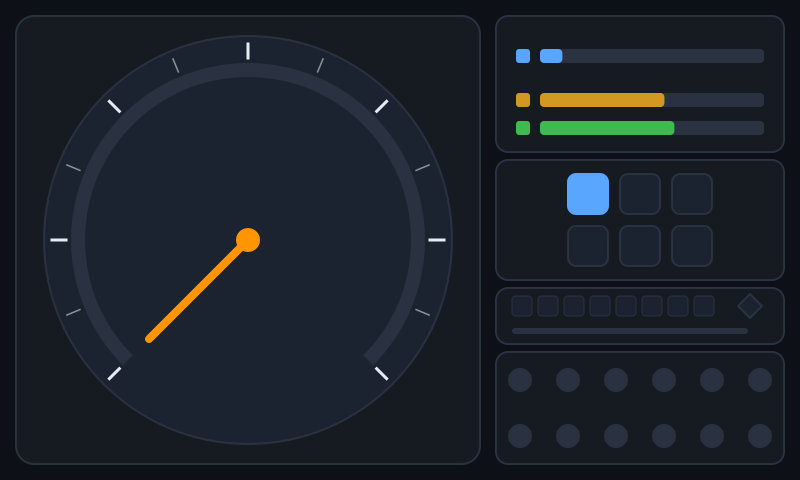
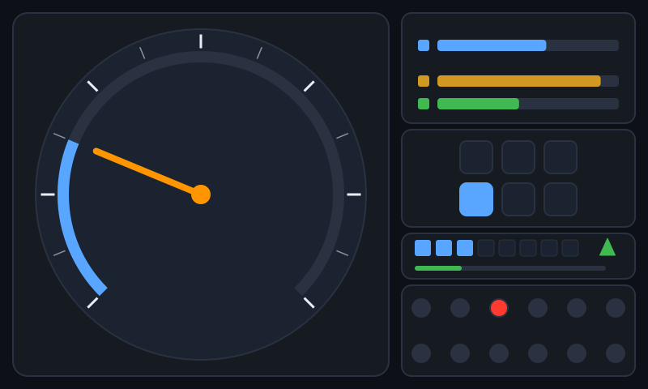

# 25 · HMI 视觉自动化测试：让"画面对不对"可自动化

> **本章给项目补上 HMI 测试的另一半。** [09 章](09_仪表盘HMI测试实战.md)走的是"状态外置"路线——
> 把显示状态写成 JSON，断言字段（`Telltale Should Be Lit`）；但状态字段对了，**画面不一定对**：
> 布局错位、颜色画错、警告灯没画出来、指针卡死……这些 GUI 缺陷只有"看像素"才能抓到。
>
> 本章新建一个完整模块，用 **PySide6 离屏渲染 + 纯像素比对** 做视觉测试闭环：
> 黄金图（golden）→ 整图/区域比对 → 红色差异图 → 指针角度识别 → 警告灯区域识别 →
> mutation 用例证明"比对不是恒真"。
>
> ```bash
> # 模块四件套（全部新增，不改动原有代码）
> simulators/cluster_canvas.py      # 确定性离屏渲染器（被测画面，800x480，无字体依赖）
> libraries/VisionLibrary.py        # 15 个视觉关键字（比对/角度/灯/差异图/基准管理）
> tests/robot/09_hmi_vision.robot   # 10 个用例（10/10 全绿，连跑两次一致）
> simulators/golden/*.png           # 3 张由渲染器生成的基准图（提交 git）
>
> # 一条命令跑本章套件（约 1 秒，不需要 ECU/总线/子进程）
> .\.venv\Scripts\python.exe -m robot --outputdir results/dev_vision tests\robot\09_hmi_vision.robot
> ```

---

## 📖 零基础读法建议（先看这个）

| 优先级 | 小节 | 说明 |
|---|---|---|
| 🟢 **必读** | 25.1 / 25.2 / 25.3 | 想清楚"为什么已有 09 章还要视觉测试""黄金图怎么管"——面试最常问 |
| 🟢 **必读** | 25.4 / 25.5 | 区域、容差、指针角度三件事是视觉自动化的核心概念 |
| 🟢 **必读** | 25.8 | 10 条用例逐条精讲，对着 `09_hmi_vision.robot` 看 |
| 🟡 了解 | 25.6 / 25.7 | 渲染器与像素算法的实现细节；会改颜色/区域时回来看 |
| 🟡 了解 | 25.9 | 真实项目怎么接（真实截图、ADB、视频流、模型检测）—— 面试加分项 |
| ⚪ 可跳过 | 25.7.5 的段错误细节 | 遇到 `constBits` 崩溃时再回来看 |

**动手顺序**：先跑命令看 10/10 全绿 → 打开 `simulators/golden/cluster_default.png` 看图 →
把 `09_hmi_vision.robot` 里的 `tolerance=2.0` 改成 `0.1` 看它怎么失败 → 最后做 25.10 自查题。

---

## 25.1 为什么 HMI 还要"视觉"测试

### 25.1.1 09 章路线测不到什么

09 章的核心是"状态外置"：仪表盘把显示状态序列化成 `dashboard_state.json`，测试断言字段。
这能验证**逻辑**，但有一整类缺陷它永远抓不到，因为那些缺陷**不在状态里，只在渲染结果里**：

| 缺陷类型 | 状态字段能发现吗 | 例子 |
|---|---|---|
| 信号→状态映射错 | ✅ 能 | 水温 121℃ 但 `telltales_lit` 没有 CoolantTempHigh |
| 布局错位 | ❌ 不能 | 警告灯区域被挪到了屏幕外/被其他元素遮挡 |
| 配色错误 | ❌ 不能 | 点亮灯被画成灰色（状态字段仍是 1） |
| 元素没画出来 | ❌ 不能 | `telltales_lit` 有值，但渲染代码忘了画灯 |
| 指针卡死/角度错 | ❌ 不能 | 状态里 `speed=60`，指针却一直指 0 |
| 分辨率/主题适配 | ❌ 不能 | 换 800x480 屏后布局溢出 |
| 动画过渡异常 | ⚠️ 部分 | 状态已更新但上一帧没刷、闪烁 |

**真实项目对应**：量产 HMI 验收一定同时做两件事——① 状态/属性树断言（快、稳，测逻辑）；
② 屏幕截图比对/摄像头采集（测"呈现"）。只做①，等于"仪表盘数据对，但屏幕黑屏也能过"。

### 25.1.2 视觉测试回答的三个问题

```
① 画面对不对？   → 整图 / 区域与黄金图（golden）比对，失败出差异图
② 指针指哪？     → 按颜色识别角度（本模块：车速 0~240 → 0~270°）
③ 警告灯亮没亮？ → 按区域红色占比判定 lit / off
```

这三个问题的共同点：**答案只在像素里**，不在任何 JSON 字段里。

### 25.1.3 两条路线是互补，不是替代

| 维度 | 状态外置（09 章 / DashboardLibrary） | 视觉比对（本章 / VisionLibrary） |
|---|---|---|
| 断言对象 | 显示状态字段 | 屏幕像素 |
| 稳定性 | 极高（字段没有抗锯齿） | 高（需要容差，跨平台要留余量） |
| 速度 | 毫秒级 | 3~50ms/帧（本机实测：渲染 3~25ms、整图比对 7~50ms） |
| 缺陷覆盖 | 逻辑/映射类 | 布局/配色/渲染/指针类 |
| 依赖 | 被测系统暴露状态（测试后门） | 只要能截到图（真屏/ADB/Appium/视频） |
| 真实项目位置 | 软件在环（SIL）/ 台架脚本 | 台架相机 / HIL / 实车验收 |

> 结论：**先有状态断言保底，再叠视觉断言抓呈现缺陷**。本章的 `09_hmi_vision.robot`
> 与 03/05 套件并存，就是项目里两条路线共存的缩影。

---

## 25.2 像素比对 vs 状态断言：怎么选

一句话决策树（真实项目直接可用）：

```
这个测试点"对错"能被状态字段/属性树表达吗？
├── 能（信号映射、阈值、状态机） → 状态断言（快、稳、好维护）
└── 不能（布局/颜色/图标/指针/遮挡/分辨率）
      ├── 只关心局部元素（某个灯、某个指针） → 区域比对 + 图形识别（本章 25.4/25.5）
      └── 关心整屏呈现（改版回归）          → 整图黄金图比对（本章 25.3）
```

**面试话术**："我的 HMI 测试分两层：状态断言测'逻辑对不对'，视觉比对测'画面对不对'；
视觉比对里再分整图和 ROI 区域两种，配合 mutation 用例证明比对有灵敏度。"
—— 一句话把"会截图"提升到"懂 HMI 测试体系"。

---

## 25.3 黄金图管理（Golden Management）

### 25.3.1 基准图必须"可复现"

黄金图（golden / baseline）是**测试资产**，它回答"这个画面长什么样算对"。它必须是
**由被测渲染器生成的、可复现的**——否则基准图就是一张来路不明的截图，测试失去意义。

本项目的做法：

```
显示状态 dict ──render_state()──► QImage ──PNG 落盘──► simulators/golden/*.png ──git 提交──► CI 里作为基准
```

渲染器 `simulators/cluster_canvas.py` 是**确定性**的（固定尺寸/配色/无随机/无时间/无字体），
所以同一状态重复渲染**像素逐位相同**（本机实测两次渲染文件 SHA256 完全相同）。
这就是为什么基准图可以提交进 git。

### 25.3.2 本项目的三张基准图

| 基准图 | 对应状态 | 用途 | 大小 |
|---|---|---|---|
| [`cluster_default.png`](../simulators/golden/cluster_default.png) | 0 km/h、灯光全灭、P 档（默认状态） | 视觉回归基线（用例 1/5/6/10 引用） | 32,188 B |
| [`cluster_60kmh_alarm.png`](../simulators/golden/cluster_60kmh_alarm.png) | 60 km/h、水温 121℃、**CoolantTempHigh 点亮**、D 档 | 报警场景基准（用例 3 引用） | 36,516 B |
| [`cluster_all_telltales.png`](../simulators/golden/cluster_all_telltales.png) | 120 km/h、**12 灯全亮**（灯光自检/EOL 画面） | 全灯场景参考 + 文档演示 | 35,486 B |



> 📊 上图：`cluster_default.png`。左侧车速表（0~240 km/h，135° 起顺时针 270°），右侧从上到下
> 是转速/水温/油量三条、档位块（3x2 无文字，亮块=档位）、信息面板（媒体音量块 + 导航三角 + 小计里程条）、
> 12 个警告灯圆点（点亮红 `#ff3b30` / 熄灭灰 `#2a3140`）。**画面里没有一个文字**——原因见 25.6.1。



> 📊 上图：`cluster_60kmh_alarm.png`。车速 60 → 蓝色进度弧扫过 67.5°；水温 121℃（超 120 阈值）
> → 第 3 个警告灯（CoolantTempHigh）变红；档位 D 亮第 4 个块。

**重新生成基准图**（渲染器是唯一来源）：

```bash
.\.venv\Scripts\python.exe simulators\cluster_canvas.py --preset default        --out simulators\golden\cluster_default.png
.\.venv\Scripts\python.exe simulators\cluster_canvas.py --preset 60kmh_alarm   --out simulators\golden\cluster_60kmh_alarm.png
.\.venv\Scripts\python.exe simulators\cluster_canvas.py --preset all_telltales --out simulators\golden\cluster_all_telltales.png
```

**可复现校验**（生成到临时目录，和 git 里的基准图比哈希）：

```powershell
.\.venv\Scripts\python.exe simulators\cluster_canvas.py --preset default --out results\vision\regen.png
Get-FileHash simulators\golden\cluster_default.png, results\vision\regen.png -Algorithm SHA256
# 本机实测二者 SHA256 完全一致（D56AECD8... 前缀）→ 渲染确定性成立
```

### 25.3.3 更新基准：显式、人工复核、随代码提交

基准图的更新只有一条路：**显式调用 `Update Golden` / `Save Golden`，人工看过新画面，然后 git 提交**。

```robotframework
# 方式一：关键字（在临时脚本里跑一次，人工确认后提交）
${png}=    Render Cluster State    ${{ {"speed": 60} }}    results/vision/speed60.png
Update Golden    ${png}    cluster_default.png

# 方式二：命令行重新生成（推荐，preset 是唯一事实来源）
python simulators/cluster_canvas.py --preset 60kmh_alarm --out simulators/golden/cluster_60kmh_alarm.png
```

**反模式（绝对不要做）**：测试失败时自动把实际截图覆盖成基准图。那样会把 bug 固化成"预期"，
视觉测试从此失去意义。**基准图的每一次变化都必须出现在 code review 的 diff 里。**

### 25.3.4 跨平台的基准策略

黄金图在本机（Windows）生成、提交，CI（ubuntu）上比对，会碰到一个现实问题：
**不同平台 Qt 抗锯齿的舍入可能有亚像素差异**。两种策略：

| 策略 | 做法 | 优缺点 |
|---|---|---|
| 每平台一份基准 | `golden/win/`、`golden/linux/` 各放一份 | 最稳，但基准翻倍、维护成本高 |
| **一份基准 + 容差**（本项目） | 一份 golden + 2% 差异比例容差 + 单像素通道容差 32 | 简单，能容忍抗锯齿噪声；容差见 25.4.3 |

> 本项目选"一份基准 + 容差"：因为渲染器**无字体、无窗口、固定尺寸**，跨平台差异只来自
> 抗锯齿，量级远小于真实缺陷（实测车速 240 vs 0 的差异 3.65%，是容差的近 2 倍）。
> 真实带字体的 HMI 项目建议改用"每平台/每分辨率一份基准"，因为字体渲染差异通常很大。

---

## 25.4 区域与容差

### 25.4.1 整图比对 vs 区域比对（ROI）

| 方式 | 关键字 | 适用 | 风险 |
|---|---|---|---|
| 整图比对 | `Compare With Golden` | 改版回归、启动画面、全屏断言 | 任何无关变化都会失败（比如车速变了） |
| 区域比对 | `Compare Region With Golden` | 只关心某个灯/某个控件 | 需要维护 ROI 坐标；可能漏掉区域外缺陷 |

本项目的第 6 条用例就是活教材：车速 240 让**整图差异 3.65%**，但警告灯区域
`(603, 367, 26, 26)` 差异 **0.00%**——区域比对通过，整图比对失败。选择哪一种，
取决于"这个测试点到底关心什么"。

### 25.4.2 警告灯区域常量（`TELLTALE_REGIONS`）

12 个灯排成右侧 2 行 x 6 列，每个圆点半径 11px，检测区域 = 圆点外接方框（外扩 2px 吸收抗锯齿边）。
坐标由渲染器 `simulators/cluster_canvas.py` 生成，测试用 `Get Telltale Region` 按名字查询，
**不在用例里写死魔法数字**——渲染器改布局，测试自动跟随：

| 行 | 列 1 | 列 2 | 列 3 | 列 4 | 列 5 | 列 6 |
|---|---|---|---|---|---|---|
| 1 | MilWarning `(507,367,26,26)` | OilPressureLow `(555,367)` | **CoolantTempHigh** `(603,367)` | BatteryLow `(651,367)` | AbsFault `(699,367)` | AirbagFault `(747,367)` |
| 2 | SeatbeltWarning `(507,423,26,26)` | TurnLeft `(555,423)` | TurnRight `(603,423)` | HighBeam `(651,423)` | LowBeam `(699,423)` | ParkBrake `(747,423)` |

> 表格里后 5 列省略的 `,26,26` 与第 1 列相同，即 `(x, y, 26, 26)`。

### 25.4.3 两层容差：为什么不能"逐位相等"

视觉比对有两个独立容差，缺一不可：

| 容差 | 常量 | 默认值 | 作用 |
|---|---|---|---|
| **单像素通道容差** | `PIXEL_COLOR_TOLERANCE` | 32（0~255） | 抗锯齿边缘像素是"前景色和背景色的混合"，两个平台混合比例可能差 1~2%，通道差 < 32 视为同色，避免误报 |
| **差异比例容差** | `DEFAULT_TOLERANCE` | 2% | 允许全图 2% 的像素有差异；跨平台抗锯齿噪声通常 < 0.5%，真实缺陷（指针动 60°、灯亮/灭）远大于 2% |

**本项目实测的差异比例（同一台机器，作为"变化幅度标尺"）**：

| 场景 | 差异比例 | 说明 |
|---|---|---|
| 基准图 vs 重新渲染的基准图 | **0.0000%**（0/384000 像素） | 渲染确定性，逐位一致 |
| 车速 0 → 60 | **1.3724%** | 进度弧 67.5° + 指针移动 |
| 车速 0 → 60 且水温灯亮 | **1.4589%** | 比上一行多 **0.0865%**（一个灯的红/灰面积） |
| 车速 0 → 240 | **3.6534%**（14029/384000 像素） | 进度弧 270° + 指针大角度移动 |
| 水温灯区域：亮 vs 灭 | **0.0000%** → 红色占比 49.11% vs 0% | 区域只差一个灯，完美局部断言 |

> 所以 mutation 用例敢断言"差异 ≥ 2% 才叫有灵敏度"：**2% 是抗锯齿噪声与真实变化之间的分界线**。
> 这也是视觉测试最重要的工程判断：**容差不是越小越好，而是"真实缺陷的差异 >> 噪声"**。

### 25.4.4 调容差的姿势

- 误报（flaky）多 → 先查渲染是否真的确定（有没有时间/随机/字体/GPU），再考虑加容差；
- 漏报（bug 没抓到）→ 用 mutation 用例证明灵敏度：故意改状态，要求比对**必须失败**；
- 容差、阈值都集中成常量（`VisionLibrary.py` 顶部、`cluster_canvas.py` 顶部），不要在用例里散落魔法数字。

---

## 25.5 指针角度算法（纯像素，不用机器学习）

### 25.5.1 角度换算

车速表量程 0~240 km/h，映射到 135°（左下）起、顺时针 270° 到右下：

```
扫过角度 = speed / 240 * 270°
  0 km/h  →   0°（指左下）
 60 km/h  →  67.5°
120 km/h  → 135°（正上）
240 km/h  → 270°（指右下）
```

### 25.5.2 屏幕角度 vs 仪表角度

```
            270°(上)
              ▲
   225° ◄─────┼─────► 315°       屏幕坐标系：0°=右，顺时针增大（y 轴向下）
        ╱     │     ╲             指针屏幕角度 = 135 + 270 * (speed/240)
  180° ●──────●──────● 0°/360°   仪表扫过角度 = (屏幕角度 - 135) % 360
        ╲     │     ╱
   135° ◄─────┴─────► 45°   ← 0 刻度在左下 135°，满量程在 405°(=45°)
```

> 注意：Qt 的 `drawArc` 角度是"0°=3 点钟、逆时针为正"，和屏幕坐标（y 向下）**方向相反**，
> 所以渲染代码里用 `start_qt = -135`、`span_qt = -270`（顺时针 = 负 span）。这是 HMI 画表盘
> 最常见的坑之一，写完一定截图看一眼（本项目的 25.6.4 就是这么验的）。

### 25.5.3 四步识别算法

```python
# simulators/cluster_canvas.py: measure_needle_angle()
1. 颜色匹配：在表盘区域内找"指针专属橙" #ff9500 的像素（通道容差 24）
2. 排除轴盖：丢掉半径 < 40px 的实测点（中心橙色轴盖会把方向拉向圆心）
3. 尖端拟合：取离圆心最远的一圈（半径差 6px 内）做向量平均，得到指针方向
   sum_dx = Σ dx; sum_dy = Σ dy; screen_deg = degrees(atan2(sum_dy, sum_dx))
4. 角度换算：sweep = (screen_deg - 135) % 360
```

**为什么不用"最远单点"**：抗锯齿会让指针圆头末端出现一两个离群像素，单点角度抖动可达 2~3°；
改成"最远一圈像素向量平均"后实测误差 < 0.25°，2° 容差非常稳。

### 25.5.4 实测精度（用例 2 覆盖 0/60/120/240 四个点）

| 车速 | 期望扫过角度 | 识别值 | 偏差 |
|---|---|---|---|
| 0 km/h | 0.00° | 0.29° | 0.29° |
| 60 km/h | 67.50° | 67.59° | 0.09° |
| 120 km/h | 135.00° | 134.79° | 0.21° |
| 240 km/h | 270.00° | 270.00° | 0.00° |

### 25.5.5 真实项目的算法演进

| 方法 | 优点 | 缺点 | 适用 |
|---|---|---|---|
| 颜色 + 最远点 | 实现 10 行，够用 | 对噪声/刻度颜色敏感 | 教学、固定主题 HMI |
| **颜色 + 向量拟合**（本章） | 稳、快、无依赖 | 需要知道指针颜色 | 颜色固定的仪表 |
| 霍夫直线 / 模板匹配 | 不依赖颜色，可找任意指针 | 慢、参数多、旋转模板要预先准备 | 通用视觉库 |
| 关键点模型（轻量 CNN） | 抗光照/主题变化 | 要训练数据、要模型文件、CI 依赖重 | 研发期工具链、多主题 |

> 面试话术："指针角度我先用**颜色分割 + 尖端向量拟合**解决固定主题仪表——20 行代码、误差 0.2°；
> 跨主题场景再升级到模板匹配/关键点模型，但先算清楚成本收益。"

---

## 25.6 离屏渲染器：`simulators/cluster_canvas.py`

### 25.6.1 三条铁律

| 铁律 | 做法 | 为什么 |
|---|---|---|
| **确定性** | 固定 800x480、固定配色、无随机/时间/字体，同一状态两次渲染像素逐位相同 | 基准图可提交 git；测试不 flaky |
| **离屏** | import PySide6 **之前** `os.environ.setdefault("QT_QPA_PLATFORM", "offscreen")` | 不弹窗口；Windows 和 Linux CI（无 X11）都能跑 |
| **无字体依赖** | 画面里**一个文字都没有**，信息用色块/圆弧/三角/方块表达 | 离屏环境没有字体目录，`QFont` 会 fallback → 不同机器字形不同 → 基准图必漂 |

```python
# 关键三行：顺序错了就可能在 Windows 上尝试开真窗口
import os
os.environ.setdefault("QT_QPA_PLATFORM", "offscreen")
from PySide6.QtGui import QImage, QPainter     # 之后才 import Qt

# QApplication 懒创建单例：RF 进程里只在第一次渲染时初始化一次
def ensure_qt_app():
    app = QApplication.instance()
    return app if app is not None else QApplication([])
```

> 离屏环境偶尔会打印 `Cannot find font directory` 类警告——**我们不用字体，所以只是噪声**，
> 不影响测试结果。不要为了消警告去装字体包，那会让 CI 变重且不解决问题。

### 25.6.2 画面布局（800x480）

```
┌──────────────────────────────────────────┬─────────────────┐
│  车速表面板 (16,16,464,448)               │ 三条 bars 面板   │
│  ┌────────────────────────────────────┐  │ (496,16,288,136)│
│  │       ╭───进度弧 0~270°───╮         │  │ ▭ 转速         │
│  │     ╱     刻度 13 个       ╲        │  │ ▭ 水温         │
│  │    │        指针           │        │  │ ▭ 油量         │
│  │    │        #ff9500        │        │  ├─────────────────┤
│  │     ╲        中心轴盖      ╱        │  │ 档位块 3x2       │
│  │       ╰──────────────────╯         │  │ (496,160,288,120)│
│  │        （下方留 90° 缺口）          │  ├─────────────────┤
│  │                                    │  │ 信息面板         │
│  └────────────────────────────────────┘  │ 音量块+导航箭头   │
│                                          │ +小计里程条      │
│                                          ├─────────────────┤
│                                          │ 12 警告灯 2x6    │
│                                          │ (496,352,288,112)│
└──────────────────────────────────────────┴─────────────────┘
```

### 25.6.3 状态 dict 字段（兼容 `dashboard_state.json`）

| 字段（教学命名） | 兼容命名（`dashboard_state.json`） | 默认值 | 渲染成什么 |
|---|---|---|---|
| `speed` | `speed_kmh` | 0 | 指针角度 + 蓝色进度弧 |
| `rpm` | `rpm` | 800 | 转速条长度（0~8000 映射） |
| `coolant` | `coolant_c` / `coolant_temp` | 90 | 水温条（40~130℃ 映射） |
| `fuel` | `fuel_pct` | 60 | 油量条（0~100%） |
| `gear` | `gear`（"P"/3 都支持） | "P" | 3x2 档位块中亮的那块 |
| `telltales` | `telltales_lit`（列表）或 `telltales`（dict） | 全灭 | 12 个灯圆点红/灰 |
| `trip.km` | `trip.km` | 0 | 信息面板小计里程条（50km 满格） |
| `media.volume` | `media.volume` | 0 | 信息面板 8 个音量块 |
| `navi.turn` | `navi.turn` | 0 | 导航箭头方向（三角旋转 0/1/2/3/4/5/6/7） |

> `normalize_state()` 负责把两套命名归一化：所以 `{"telltales_lit": ["CoolantTempHigh"]}`
> 与 `{"telltales": {"CoolantTempHigh": 1}}` 渲染结果**完全一致**——这就是数据契约的容错层。
> 需求里写的 12 个灯全部支持，名字与 `simulators/dashboard.py` 的 `TELLTALE_UI` 一致。

### 25.6.4 颜色与几何常量（改主题只改这里）

| 常量 | 值 | 用途 |
|---|---|---|
| `COLORS["bg"]` | `#0d1117` | 画布背景（对齐 `cluster_gui.py` 深色座舱主题） |
| `COLORS["panel"]` / `panel2` | `#161b22` / `#1c2330` | 面板底 / 面板亮 |
| `COLORS["border"]` | `#2a3140` | 边框、未激活块、熄灭灯 |
| `COLORS["accent"]` | `#58a6ff` | 进度弧 / 转速条 / 档位块 |
| `COLORS["needle"]` | `#ff9500` | **指针专用橙：仪表内唯一该颜色 → 角度识别依据** |
| `COLORS["telltale_lit"]` | `#ff3b30` | 警告灯点亮（统一红；真实仪表不同灯颜色不同，见 25.9.2 局限） |
| `COLORS["telltale_off"]` | `#2a3140` | 警告灯熄灭（灰） |
| `SPEED_GAUGE` | 圆心 (248,240)、半径 170、环宽 14、指针长 140、粗 8、`start=135°`、`sweep=270°` | 车速表几何 |
| `TELLTALE_REGIONS` | 名称 → `(x, y, 26, 26)` | 12 灯检测区域（测试按名字查） |

> **颜色即契约**：指针颜色变了、灯点亮色变了，识别算法的常量必须同步改——所以颜色集中在
> `COLORS`，文档和测试都引用它，绝不散落魔法值。

### 25.6.5 API 与命令行

| 函数/常量 | 说明 |
|---|---|
| `render_state(state) -> QImage` | 渲染（`state` 可为 dict / JSON 路径 / None） |
| `render_state_to_png(state, path) -> Path` | 渲染并保存 PNG（自动建目录） |
| `load_state(path) -> dict` | 读状态文件（对"半写文件"带 5 次重试） |
| `normalize_state(state) -> dict` | 字段归一化（兼容两套命名，缺省补默认值） |
| `measure_needle_angle(image) -> float` | 指针角度识别（0~270°） |
| `TELLTALE_REGIONS` / `SPEED_GAUGE` / `TELLTALE_GRID` / `GEAR_LAYOUT` | 公开几何常量 |
| `PRESET_STATES` | 预设状态：`default` / `60kmh_alarm` / `all_telltales` |

```bash
# 渲染预设状态（生成基准图）
.\.venv\Scripts\python.exe simulators\cluster_canvas.py --preset default --out simulators\golden\cluster_default.png

# 渲染实时状态文件（headless 仪表盘正在写的 dashboard_state.json）
.\.venv\Scripts\python.exe simulators\cluster_canvas.py --state simulators\dashboard_state.json --out results\vision\live.png

# 输出：已渲染 800x480 -> ...  /  指针角度识别值: 67.59° （车速 60.0 km/h）
```

---

## 25.7 关键字库：`libraries/VisionLibrary.py`

### 25.7.1 关键字清单（15 个）

| # | 关键字 | 回答什么问题 | 返回 |
|---|---|---|---|
| 1 | `Render Cluster State` | 把状态 dict / 状态文件渲染成 PNG | 截图路径 |
| 2 | `Capture Cluster Screenshot` | 抓一帧截图（本环境=离屏渲染；真实项目换真屏截图） | 截图路径 |
| 3 | `Save Golden` | 存基准图（显式、人工确认） | 基准图路径 |
| 4 | `Compare With Golden` | **整图**与基准图比，容差内通过否则报错存差异图 | 差异比例 |
| 5 | `Compare Region With Golden` | **指定区域**（x/y/w/h）与基准图比 | 差异比例 |
| 6 | `Image Diff Ratio` | 两张图的差异比例（`color_tolerance=0` 即严格相等） | 差异比例 |
| 7 | `Images Should Differ` | 断言"确实有差异"≥ 最小值（防比对恒真/灵敏度证明） | 差异比例 |
| 8 | `Save Diff Image` | 生成红框差异图（失败现场证据） | 差异图路径 |
| 9 | `Update Golden` | 显式更新基准图（改版/首次建基准） | 基准图路径 |
| 10 | `Telltale Region Should Be Lit` | 灯区域红色占比 ≥ 25% → lit | 红色占比 |
| 11 | `Telltale Region Should Be Off` | 灯区域红色占比 ≤ 5% → off | 红色占比 |
| 12 | `Get Telltale Region` | 按灯名查检测区域 `[x,y,w,h]`（不写死坐标） | 区域坐标 |
| 13 | `Get Needle Angle` | 从截图识别指针角度（0~270°） | 角度（度） |
| 14 | `Needle Angle Should Be Near` | 指针角度在期望 ±2° 内 | 实际角度 |
| 15 | `Count Red Pixels` | 统计接近纯红像素数（证明差异图非空白） | 像素数 |

### 25.7.2 纯 PySide6 像素比对（不装 Pillow/numpy/OpenCV）

`libraries/VisionLibrary.py` 的核心比较只用了内置类型 + QImage 的原始像素缓冲：

```python
# 取像素：Format_RGB32 = B,G,R,A 每像素 4 字节；同一张图把内存视图取出来
data = bytes(image.constBits())           # 1.5MB（800*480*4）
# 比较：逐行先做整行 bytes 相等快速通道（黄金图自检几乎零成本），
#       有差异的行再逐像素判断：任一通道差 > 32 才算"不同"
if data_a[row:row+3200] == data_b[row:row+3200]:
    continue
if abs(a[i] - b[i]) > color_tolerance or ...:  # B/G/R 三个通道各判一次
    diff_indices.append(y * width + x)
```

**两个性能设计**：
1. **整行快速通道**：相同行为主时（比如只改了某个区域）跳过绝大多数像素；
2. **差异下标收集**：一次比较同时得到差异比例 + 差异像素坐标，供差异图直接复用。

> 为什么不用 numpy/Pillow：少一个依赖就少一个 CI 环境坑（本项目的 CI 是 ubuntu + 最小依赖），
> 而 800x480 的逐像素比较在纯 Python 下也只要几十毫秒——够用优先于先进。

### 25.7.3 差异图：红框 + 红色高亮

```python
# 底图 = 实际截图；差异像素覆盖纯红 #ff0000；再用红框圈出差异的包围盒
buffer[offset:offset+4] = b"\x00\x00\xff\xff"     # RGB32 小端内存序 = B,G,R,A
painter.setPen(QPen(QColor(255, 0, 0), 3))
painter.drawRect(QRect(min_x - 2, min_y - 2, max_x - min_x + 5, max_y - min_y + 5))
```

实测差异图（车速 240 vs 默认基准，14029/384000 像素不同）：蓝弧和指针被红色覆盖，外围红框
圈出表盘区域，右侧未变化的条/灯保持原样。**差异图进 CI artifact 或缺陷单，比"断言挂了"四个字有用一百倍。**

> 高亮用**纯红 #ff0000** 而不是仪表红 #ff3b30，是为了让 `Count Red Pixels`（R≥200 且 G≤60 且 B≤60）
> 能区分"差异高亮"和"灯本身的红"——细节决定"差异图非空白"这个断言能不能写。

### 25.7.4 警告灯 lit/off 判定：区域红色占比

```python
# 区域里逐像素判断"够红"：R ≥ 120 且 R-G ≥ 60 且 R-B ≥ 60
# 实测：点亮灯区域红色占比 49.11% ≥ 阈值 25% → lit
#       熄灭灯区域红色占比 0.00%  ≤ 阈值 5%  → off
```

阈值定 25%/5% 的依据：圆点面积占检测区域的约 48%（πr²/边长²），留一倍的余量吸收抗锯齿。

### 25.7.5 一个真实的 PySide6 踩坑：`constBits()` 生命周期段错误

**错误写法**（本项目调试时真的段错误退出码 `0xC0000005`）：

```python
raw = bytes(QImage(path).convertToFormat(QImage.Format.Format_RGB32).constBits())
#                      ↑ 临时 QImage 在链式调用结束后被回收
#                                   ↑ constBits() 返回的是悬空内存视图 → 进程直接崩
```

**正确写法**（先绑定变量，保持对象存活到 `bytes()` 拷完）：

```python
image = QImage(path).convertToFormat(QImage.Format.Format_RGB32)
raw = bytes(image.constBits())     # image 变量存活期间安全
```

> 教训：C++ 对象的"裸内存视图"在 Python 侧没有生命周期保护。这类崩溃**没有 Python 堆栈**，
> 只看得到退出码 —— 排错时先把"临时对象 + 裸内存"的可疑链式调用拆开。

### 25.7.6 阈值常量表（`VisionLibrary.py` 顶部集中管理）

| 常量 | 默认值 | 含义 |
|---|---|---|
| `DEFAULT_TOLERANCE` | `0.02` | 整图/区域差异比例容差（2%） |
| `PIXEL_COLOR_TOLERANCE` | `32` | 单像素任一通道差 ≤ 32 视为同色 |
| `TELLTALE_LIT_MIN_RATIO` | `0.25` | 灯区域红色占比 ≥ 25% 判 lit |
| `TELLTALE_OFF_MAX_RATIO` | `0.05` | 灯区域红色占比 ≤ 5% 判 off |
| `TELLTALE_RED_MIN_BRIGHTNESS` | `120` | "够红"的 R 通道亮度下限 |
| `TELLTALE_RED_MIN_GAP` | `60` | R 比 G/B 至少高 60 才叫红 |
| `NEEDLE_ANGLE_TOLERANCE_DEG` | `2.0` | 指针角度默认容差（度） |

---

## 25.8 逐条讲 `tests/robot/09_hmi_vision.robot`（10 条用例）

**为什么这个套件不需要 Suite Setup 起 ECU/总线**：被测对象是"渲染器 + 视觉断言链路"，
不依赖 CAN 信号和子进程。纯离屏渲染 + 纯像素比对 → 秒级完成（实测整套 0.97~1.00 秒）、
结果确定、任何机器可复现。这也说明**模块化测试的设计**：视觉模块可以独立于动力/诊断模块运行。

| # | 用例 | 需求标签 | 断言层次 |
|---|---|---|---|
| 1 | 默认状态整图应与黄金图一致 | REQ-VIS-001 仪表画面基准比对 | 整图比对 |
| 2 | 车速 60 与 120 时指针角度应约为 67.5 度与 135 度 | REQ-VIS-002 指针角度与车速一致 | 图形识别 |
| 3 | 水温报警灯点亮时对应区域应识别为 lit | REQ-VIS-003 警告灯区域识别 | 区域颜色 |
| 4 | 同一区域灯灭时应识别为 off | REQ-VIS-003 警告灯区域识别 | 区域颜色（负向） |
| 5 | 状态变化时必须能被比对检出（mutation） | REQ-VIS-004 视觉变化检测灵敏度 | 灵敏度证明 |
| 6 | 只比警告灯区域时车速变化不应影响比对结果 | REQ-VIS-001 / 003 | ROI 比对 |
| 7 | 差异图应生成且包含红色高亮 | REQ-VIS-004 视觉变化检测灵敏度 | 证据完整性 |
| 8 | 同一状态两次渲染应像素完全一致（渲染确定性） | REQ-VIS-004 视觉变化检测灵敏度 | 可复现性 |
| 9 | 黄金图缺失时应给出清晰报错 | REQ-VIS-001 仪表画面基准比对 | 错误信息 |
| 10 | 灯亮与车速变化的整图差异比例排序应合理 | REQ-VIS-004 视觉变化检测灵敏度 | 数量级断言 |

### 25.8.1 用例 1：默认状态整图应与黄金图一致

```robotframework
默认状态整图应与黄金图一致
    [Tags]    REQ-VIS-001
    ${png}=    Render Cluster State    ${{ {}}}    ${OUT}/default.png
    ${ratio}=    Compare With Golden    ${png}    ${GOLDEN_DEFAULT}
    Should Be True    ${ratio} <= 0.02
```

**测什么**：视觉回归基线。**`${{ {}} }` 是 RF 的内联 Python 表达式**——空 dict 表示"全部用默认值"，
渲染结果应与提交在 git 里的 `cluster_default.png` 逐像素一致（实测差异 0.0000%）。

**为什么断言"≤ 2%"而不是"= 0"**：同机确实为 0，但 CI 的 ubuntu 与基准图生成环境（Windows）
抗锯齿可能差亚像素；容差是给合法噪声留的，不是给 bug 留的（下一个 mutation 用例专门证明这一点）。

### 25.8.2 用例 2：指针角度

```robotframework
    ${png60}=    Render Cluster State    ${{ {"speed": 60} }}    ${OUT}/speed_60.png
    Needle Angle Should Be Near    ${png60}    67.5    tolerance=2.0
    ${png120}=    Render Cluster State    ${{ {"speed": 120} }}    ${OUT}/speed_120.png
    Needle Angle Should Be Near    ${png120}    135.0    tolerance=2.0
```

**测什么**：`Get Needle Angle` 能从像素里识别指针，且角度与车速换算一致。覆盖 60°/135° 两个点
（再加 240° 端点，等于验证了量程两端和中间）。实测识别值 67.59° / 134.79° / 270.00°，
偏差 ≤ 0.21°。

**这条用例能抓什么真实缺陷**：渲染代码把指针角度算错（比如方向搞反、量程映射错）、指针卡死、
指针颜色画错（识别不到会报"找不到指针"）。**注意它不经过 JSON**——完全"看图说话"。

### 25.8.3 用例 3：水温报警灯点亮 → 区域 lit

```robotframework
    ${state}=    Evaluate    {"speed": 60, ..., "telltales": {"CoolantTempHigh": 1}, ...}
    ${png}=    Render Cluster State    ${state}    ${OUT}/alarm.png
    Compare With Golden    ${png}    ${GOLDEN_ALARM}          # ①整图对报警基准
    ${ratio}=    Telltale Region Should Be Lit    ${png}    CoolantTempHigh   # ②区域 lit
    Should Be True    ${ratio} > 0.25
```

**测什么**：两条断言叠加——① 整图与"报警场景基准图"一致（画面整体回归）；② 目标灯区域红色占比
**49.11% ≥ 25%** 判定 lit。区域坐标由 `Get Telltale Region` 查（用例不写死）。这条用例同时
验证了"状态 dict → 像素"的完整链路。

### 25.8.4 用例 4：同一区域灯灭 → off

```robotframework
    ${state}=    Evaluate    {"speed": 60, "rpm": 4800, "coolant": 121, "fuel": 45, "gear": "D"}
    ${png}=    Render Cluster State    ${state}    ${OUT}/lamp_off.png
    ${ratio}=    Telltale Region Should Be Off    ${png}    CoolantTempHigh
    Should Be True    ${ratio} <= 0.05
```

**测什么**：**负向断言**——同样的车速/水温，只把灯信号设为 0，区域红色占比实测 0.00% ≤ 5%。
3/4 两条用例是成对的："亮→lit、灭→off"，才能证明区域识别**不是恒真**（永远返回 lit 的 bug 会被 4 抓住）。

### 25.8.5 用例 5：mutation——证明比对不是恒真（最重要的一条）

```robotframework
    ${baseline}=    Render Cluster State    ${{ {}}}    ${OUT}/mutation_baseline.png
    ${mutated}=    Render Cluster State    ${{ {"speed": 240} }}    ${OUT}/mutation_speed240.png
    Images Should Differ    ${mutated}    ${baseline}    min_ratio=0.02   # ①灵敏度 ≥2%
    Run Keyword And Expect Error    *整图与黄金图不一致*
    ...    Compare With Golden    ${mutated}    ${GOLDEN_DEFAULT}        # ②比对必须失败
```

**测什么**：视觉测试最大的坑是**比对恒真**——差分算法写错、容差设成 1.0、把图缩成 1×1 再比，
所有用例都会"通过"却什么都没验证。这条用"测试的测试"（mutation testing）思路：

1. 故意把状态从 0 km/h 改成 240 km/h（指针/进度弧大幅变化，实测差异 **3.6534%**）；
2. 要求 `Images Should Differ` 认为"有差异 ≥ 2%"（灵敏度足够）；
3. 要求 `Compare With Golden` **必须抛错**（`Run Keyword And Expect Error` 锁死错误信息）。

> 面试话术："视觉测试我会写一条 mutation 用例：故意改状态，比对必须失败。这条用例通过，
> 才说明我的视觉断言真的在验证东西。" —— 绝大多数候选人想不到这一层。

### 25.8.6 用例 6：区域比对——只关心警告灯

```robotframework
    ${png}=    Render Cluster State    ${{ {"speed": 240} }}    ${OUT}/region_speed240.png
    ${whole}=    Image Diff Ratio    ${png}    ${GOLDEN_DEFAULT}
    Should Be True    ${whole} > 0.02          # 车速 240 → 整图差异 3.65%
    ${region}=    Get Telltale Region    CoolantTempHigh
    ${ratio}=    Compare Region With Golden    ${png}    ${GOLDEN_DEFAULT}
    ...    ${region}[0]    ${region}[1]    ${region}[2]    ${region}[3]
    Should Be True    ${ratio} <= 0.02         # 灯区域差异 0.00% → 通过
```

**测什么**：区域比对（ROI）的价值。**同样两张图**：整图差异 3.65%（会失败），警告灯区域差异
0.00%（通过）。真实项目里"只关心局部变化"时（比如只验警告灯，不管仪表翻页动画/车速变化），
区域比对能显著降低误报。

### 25.8.7 用例 7：差异图生成且非空白

```robotframework
    ${diff}=    Save Diff Image    ${mutated}    ${GOLDEN_DEFAULT}    ${OUT}/diff_speed240.png
    File Should Exist    ${diff}
    ${red}=    Count Red Pixels    ${diff}
    Should Be True    ${red} > 1000
```

**测什么**：失败证据链。差异图 = 实际截图 + 纯红高亮差异像素 + 红框圈差异范围；断言文件存在且
红色像素 > 1000（实测差异像素 14029 个，不是空白图）。**视觉测试失败时，差异图是最有说服力的证据。**

### 25.8.8 用例 8：渲染确定性

```robotframework
    ${state}=    Evaluate    {"speed": 120, "telltales": {"BatteryLow": 1}}
    ${png_render}=    Render Cluster State    ${state}    ${OUT}/determinism_render.png
    ${png_capture}=    Capture Cluster Screenshot    ${state}    ${OUT}/determinism_capture.png
    ${ratio}=    Image Diff Ratio    ${png_render}    ${png_capture}    color_tolerance=0
    Should Be Equal As Numbers    ${ratio}    0.0
```

**测什么**：视觉测试可复现的前提 = 渲染确定性。同一状态走两个入口（渲染器直调 / 截图入口）
各渲染一次，`color_tolerance=0` **严格逐像素**比较，差异必须为 0。真实项目里这是"基准图能不能信"
的第一道门禁——如果渲染不确定，黄金图比对永远 flaky，应先修渲染（去时间戳/动画/随机/字体）。

### 25.8.9 用例 9：基准图缺失时错误信息清晰

```robotframework
    ${actual}=    Render Cluster State    ${{ {}}}    ${OUT}/missing_golden_probe.png
    Run Keyword And Expect Error    *基准图不存在*
    ...    Compare With Golden    ${actual}    ${GOLDEN_DIR}/__no_such_golden__.png
```

**测什么**：基准图也是测试资产，文件被误删/路径写错时，报错必须直接说"基准图不存在 + 查了哪些
路径 + 怎么生成"，不能是 Python 的 `FileNotFoundError` 堆栈。用 `Run Keyword And Expect Error`
把错误信息里的关键词锁死——**错误信息质量也是被测对象**。

### 25.8.10 用例 10：差异比例排序合理

```robotframework
    ${ratio_base}=    Image Diff Ratio    ${base}    ${GOLDEN_DEFAULT}        # 0.0000%
    ${ratio_60}=      Image Diff Ratio    ${speed60}    ${GOLDEN_DEFAULT}    # 1.3724%
    ${ratio_60_lit}=  Image Diff Ratio    ${speed60_lit}    ${GOLDEN_DEFAULT} # 1.4589%
    ${ratio_240}=     Image Diff Ratio    ${speed240}    ${GOLDEN_DEFAULT}    # 3.6534%
    ${lamp_delta}=    Image Diff Ratio    ${speed60_lit}    ${speed60}        # 0.0865%
    Should Be True    ${ratio_base} <= 0.02
    Should Be True    0 < ${ratio_60} < ${ratio_60_lit} < ${ratio_240}
    Should Be True    0 < ${lamp_delta} < ${ratio_240}
```

**测什么**：用差异比例做"数量级"断言，证明差分对**变化方向/幅度**敏感：基准自身 ≈ 0%
< 车速 60 的 1.37% < 车速 60+水温灯亮的 1.46% < 车速 240 的 3.65%；"灯亮 vs 灯灭"的差异
0.0865% > 0（灯确实被画出来了）且远小于车速 240 的变化。**排序断言比单点阈值更能证明算法合理。**

### 25.8.11 实测结果

```
==============================================================================
09 Hmi Vision :: 套件 09：HMI 视觉自动化测试...
==============================================================================
默认状态整图应与黄金图一致                                          | PASS |
车速 60 与 120 时指针角度应约为 67.5 度与 135 度                     | PASS |
水温报警灯点亮时对应区域应识别为 lit                                | PASS |
同一区域灯灭时应识别为 off                                          | PASS |
状态变化时必须能被比对检出（mutation，证明比对不是恒真）             | PASS |
只比警告灯区域时车速变化不应影响比对结果                            | PASS |
差异图应生成且包含红色高亮                                          | PASS |
同一状态两次渲染应像素完全一致（渲染确定性）                         | PASS |
黄金图缺失时应给出清晰报错                                          | PASS |
灯亮与车速变化的整图差异比例排序应合理                              | PASS |
------------------------------------------------------------------------------
10 tests, 10 passed, 0 failed     （连跑两次均 10/10；单次约 0.97~1.00 秒）
```

---

## 25.9 真实项目怎么接

### 25.9.1 截图来源替换（`Capture Cluster Screenshot` 是唯一入口）

本模块的被测画面来自离屏渲染器。真实项目只换"截图来源"，断言层一行不改：

| 被测对象 | 截图方式 | 说明 |
|---|---|---|
| Qt/QML 仪表 | `QScreen.grabWindow()` / `QQuickItem.grabToImage()` | 同进程或远程注入 |
| 安卓车机 | `adb exec-out screencap -p > shot.png` | **`exec-out` 避免 Windows 换行污染二进制**（用 `shell screencap` 再 `pull` 也行） |
| Appium | `driver.get_screenshot_as_file(...)` | 跨 iOS/Android，元素定位 + 截图都能做 |
| 视频流/采集卡 | FFmpeg 抽帧：`ffmpeg -i video.mp4 -vf fps=2 frame_%04d.png` | 实车/台架相机视频；先做"稳定帧"检测 |
| 摄像头拍摄屏幕 | 采集卡/工业相机抓帧 | 有反光/摩尔纹/亮度变化，需要预处理（25.9.3） |

### 25.9.2 渲染替代 vs 真实截图的边界（必须知道本模块测不到什么）

**本模块验证的是**：视觉断言链路本身（比对算法/角度识别/灯检测/差异图/基准管理）+ 渲染器
"状态→像素"的映射。**它不等于真屏验证**。真实项目里以下内容仍需真屏/相机/人工：

| 真实验证项 | 本模块覆盖 | 真实项目手段 |
|---|---|---|
| 真屏色彩/亮度/背光/对比度 | ❌ | 色彩分析仪、采集卡 |
| 视角/反光/摩尔纹 | ❌ | 相机 + 图像预处理、暗室台架 |
| 字体渲染/多语言 | ❌（刻意无字体） | OCR + 各语言基准图 |
| 动画时序/过渡帧 | ❌（单帧截图） | 视频抽帧 + 连续帧差异 |
| 触控响应/交互 | ❌ | Appium / UIAutomator |
| 多分辨率/多主题适配 | ⚠️ 只能换基准 | 每分辨率一份基准图 |
| 动态内容（速度数字滚动） | ⚠️ 只验指针角度 | 掩码忽略数字区域 + OCR 抽样 |

> 面试时主动说清边界是加分项：**"我的视觉框架验证哪一层、哪一层必须上硬件"**，
> 比声称"视觉测试能替代一切"可信得多。

### 25.9.3 真实截图的预处理链

真实截图直接比会天天 flaky，标准预处理顺序：

```
原图 → ① 分辨率归一化（缩放到基准尺寸，或按 DPI 换算 ROI）
     → ② ROI 对齐（定位仪表区域/警告灯区域；可用模板匹配找表盘中心）
     → ③ 亮度/色温归一化（直方图均衡/白平衡，或容忍更大颜色差）
     → ④ 掩码忽略区域（时钟、车速数字、动画图标、倒车影像）
     → ⑤ 稳定帧判定（连续 N 帧差异 < 阈值才当"稳态"）
     → ⑥ 比对 + 差异图
```

### 25.9.4 视频流/动画测试

- 抽帧：2~5 fps 足够验证动画关键帧；
- **稳定帧检测**：连续两帧差异 < 阈值才做基准比对，避免抓到过渡帧；
- 时序断言：`第 N 帧后灯应亮`（类似 03 套件的轮询等待，但基于帧号）；
- 转向灯闪烁：按周期统计"亮/灭帧数比例"验证 1.5Hz 左右的闪烁节奏。

### 25.9.5 模型检测（目标检测/OCR）与传统比对的关系

| 手段 | 解决的问题 | 成本 |
|---|---|---|
| 像素比对（本章） | "和基准一样吗" | 低，无训练 |
| 区域颜色占比（本章） | "灯亮没亮" | 低 |
| 模板匹配 | "图标在不在、位置对不对" | 中，要模板 |
| 目标检测（YOLO 等） | "任意布局下找警告灯/指针" | 高：标注数据 + 模型 + CI 依赖 |
| OCR | "速度数字读出来是多少" | 中：多语言/多字体要调优 |

> 正确顺序：**先用像素/区域/模板解决 80%，模型检测只留给"布局不固定/真实相机"的场景**。
> 不要为了炫技上模型——模型本身也要测试，评测集/漂移/推理环境都是新成本。

### 25.9.6 CI 集成

- 差异图/失败截图上传 artifact（GitHub Actions `actions/upload-artifact`），失败单直接贴图；
- 基准图独立目录 + 评审流程（改基准 = 改代码，必须 review diff）；
- flaky 治理：先查渲染确定性，再查截图时机（稳态帧），最后才调容差；
- 跨平台：每平台一份基准 **或** 一份基准 + 容差（本项目选后者，见 25.3.4）；
- 性能：本套件 10 条用例约 1 秒，视觉测试完全可以进每次提交的 CI（不必等 nightly）。

---

## 25.10 本章自检

1. 09 章的"状态外置"路线测不到哪类缺陷？举 3 个例子，并说明视觉测试如何补上。
2. 黄金图为什么必须由确定的渲染器生成？如果直接拿手工截图当基准会有什么问题？
3. 视觉比对为什么需要"两层容差"（单像素通道容差 + 差异比例容差）？各解决什么问题？
4. 指针角度识别为什么要排除中心轴盖、为什么用"最远一圈向量平均"而不是单点？
5. 什么是 mutation 用例？它证明了什么？如果没有它会有什么风险？
6. 区域比对（ROI）的优点和风险各是什么？什么时候应该用整图比对？
7. 本模块的视觉断言在真实项目里要换成真实截图，需要额外做哪些预处理？哪些验证项本模块覆盖不了？

---

### 📋 自查要点（答完再对，别提前看）

| # | 自查要点 |
|---|---|
| 1 | 状态断言测"逻辑/映射"；**布局错位、配色错误、元素没画出来、指针卡死、分辨率适配、动画过渡**测不到。视觉断言直接比对像素/识别图形，补"呈现层"缺陷 |
| 2 | 基准图必须是**确定性渲染器**生成、可重复（同状态同像素）；手工截图可能带时间/动画/鼠标/字体差异/不同机器，无法复现 → 比对永远 flaky，且说不清"基准"从哪来 |
| 3 | 单像素通道容差（32）吸收**抗锯齿边缘混合比例差异**；差异比例容差（2%）吸收**跨平台渲染噪声**。核心原则：**真实缺陷的差异 >> 噪声**，容差不是越小越好 |
| 4 | 轴盖在圆心附近，会把"最远点方向"拉向 0；单点受抗锯齿离群像素影响抖动 2~3°，**最远一圈向量平均**后误差 < 0.25° |
| 5 | mutation = 故意改被测状态/输入，断言**必须失败**（`Run Keyword And Expect Error`）；证明比对不是恒真、灵敏度足够。没有它，差分算法写错/容差 1.0 时全部用例"通过"却零验证 |
| 6 | ROI 优点：抑制无关变化（车速变了但灯区域没变）、降低误报、定位精确；风险：区域外缺陷漏检、ROI 坐标要维护。**改版回归/整屏呈现**用整图比对 |
| 7 | 预处理：分辨率归一化、ROI 对齐、亮度/色温归一化、掩码忽略动态区域、稳定帧判定。覆盖不了：真屏色彩/亮度/视角反光、字体/多语言、动画时序、触控交互、多分辨率主题适配 |

---

**上一章** ← [24 · 车载以太网与 DoIP 诊断](24_车载以太网与DoIP诊断.md)　|　**下一章** → [26 · 非功能测试实战](26_非功能测试实战.md)
（扩展篇导航：[22 全景](22_车载自动化测试全景与能力地图.md) → [23 LIN](23_LIN总线与车身控制测试.md) → [24 DoIP](24_车载以太网与DoIP诊断.md) → **25 HMI 视觉（本章）** → [26 非功能](26_非功能测试实战.md) → [27 信息安全](27_信息安全测试入门.md) → [28 功能安全/ASPICE](28_功能安全与ASPICE测试过程.md)）

